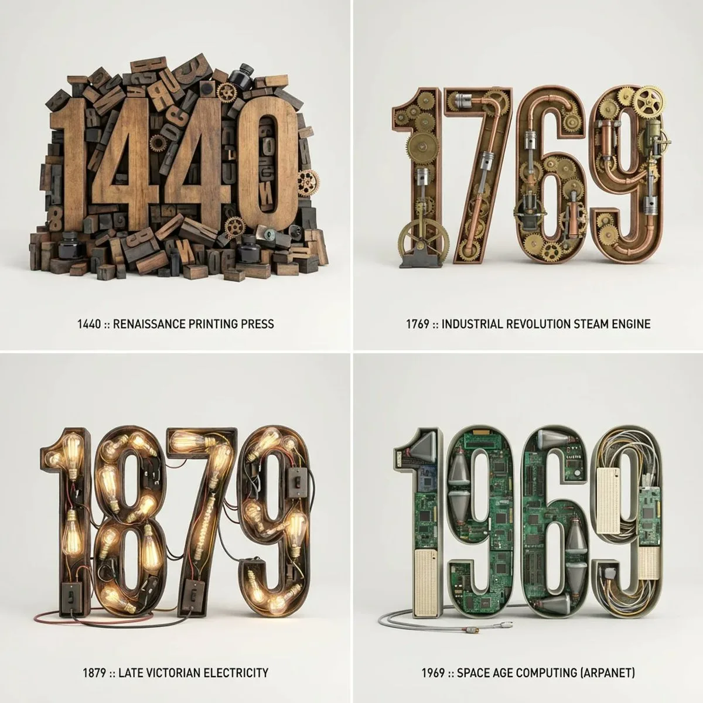

# Gadgetify — by @Gdgtify

[← Back to Community Examples](../../EXAMPLES.md) · Category: Illustration & 3D · Model: `Nano Banana`

<a href="https://x.com/Gdgtify/status/2034557489258078352"></a>

Source: **[@Gdgtify on X](https://x.com/Gdgtify/status/2034557489258078352)** · Creator: [Gadgetify](https://x.com/Gdgtify)

## Prompt

```text
2x2 grid, do this for 4 important years in history and their most important inventions  {    Anchor:   `[Letter/Number] :: [Era/Theme (e.g., 1980s Retro Tech / Victorian Steampunk)]::4`
    Morphology:   `3D Typographic sculpture of [Letter/Number], character shape defined by a dense pile of [Era/Theme] objects, chaotic but legible assemblage, graphic design asset::3`
    Material Physics:   `Textures of [Era/Theme] objects (plastic, rust, wood), occlusion between stacked items, realistic scale of constituent parts forming the glyph::3`
    Illumination:   `Three-point studio lighting, softbox overhead, clean background for isolation::2`
    Render Stack:   `Cinema 4D render, isometric or front-facing, ambient occlusion, 8k, Adobe Substance material suite::1`
    Negative:   `[Illegible, flat font, 2D, handwriting, paper, messy background, floating objects]:: -1`}
```

## Try it

Paste the prompt into **[vinano.ai](https://vinano.ai?utm_source=github&utm_medium=readme&utm_campaign=awesome-image-video-prompts-updating&utm_content=x-page-try)** to generate your own version.

> The image and prompt belong to @Gdgtify ([original post](https://x.com/Gdgtify/status/2034557489258078352)) and are shown here with credit for reference. Creators can ask for changes or removal by opening an issue.
