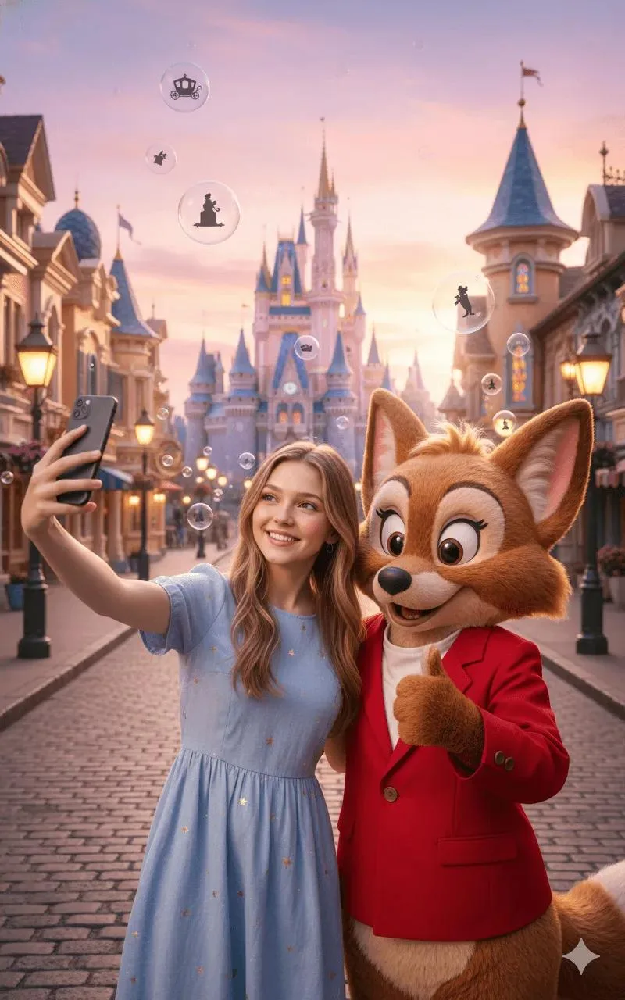

# Taaruk — by @Taaruk_

[← Back to Community Examples](../../EXAMPLES.md) · Category: Illustration & 3D · Model: `Nano Banana`

<a href="https://x.com/Taaruk_/status/2008453808968659330"></a>

Source: **[@Taaruk_ on X](https://x.com/Taaruk_/status/2008453808968659330)** · Creator: [Taaruk](https://x.com/Taaruk_)

## Prompt

```text
{
  "Objective": "Create a joyful, cinematic fantasy photograph set in a magical fairytale theme park"
      "Type": "Young woman",
      "Pose": "Taking a selfie at arm’s length",
      "Expression": "Warm, joyful smile",
      "Clothing": "Light blue dress",
      "Action": "Holding a smartphone, facing the camera"
    },
    "SecondarySubject": {
      "Type": "Anthropomorphic fox mascot",
      "Appearance": "Cute, friendly fox character",
      "Clothing": "Red jacket",
      "Pose": "Standing beside the woman, giving a thumbs-up",
      "Emotion": "Playful and welcoming"
    }
  },
  "SceneDescription": {
    "Location": "Magical fairytale theme park",
    "Foreground": "Woman and fox mascot posing for a selfie",
    "Background": {
      "Landmark": "Grand fairytale castle at the end of the street",
      "Street": "Charming cobblestone road",
      "Architecture": "Classic European-style buildings",
      "LightingElements": "Glowing vintage street lamps"
    },
    "AtmosphericDetails": {
      "FloatingElements": "Soap bubbles drifting through the air",
      "MagicalAccents": "Some bubbles contain tiny whimsical silhouettes",
      "Mood": "Whimsical, joyful, storybook magic"
    }
  },
  "LightingAndMood": {
    "TimeOfDay": "Golden hour",
    "LightingStyle": "Warm highlights with gentle shadows",
    "Sky": "Soft pastel tones",
    "OverallMood": "Dreamy, uplifting, cinematic fantasy realism"
  },
  "PhotographyStyle": {
    "Genre": "Theme park photography",
    "Composition": "Cinematic framing with strong depth",
    "DepthOfField": "Shallow depth of field",
    "DetailLevel": "Ultra-detailed textures",
    "ColorGrading": "Vibrant yet soft, pastel-enhanced",
    "Resolution": "High resolution, sharp focus on subjects"
  },
  "ArtDirection": {
    "Style": "Dreamy fantasy realism",
    "VisualTone": "Joyful, magical, immersive",
    "RealismBalance": "Photorealistic with subtle fantasy elements"
  },
  "NegativePrompt": [
    "dark mood",
    "horror",
    "low resolution",
    "blurry faces",
    "harsh shadows",
    "oversaturated colors",
    "distorted anatomy",
    "uncanny characters"
  ],
  "ResponseFormat": {
    "Type": "Single image",
    "Orientation": "Portrait",
    "AspectRatio": "2:3"
  }
}
```

## Try it

Paste the prompt into **[vinano.ai](https://vinano.ai?utm_source=github&utm_medium=readme&utm_campaign=awesome-image-video-prompts-updating&utm_content=x-page-try)** to generate your own version.

> The image and prompt belong to @Taaruk_ ([original post](https://x.com/Taaruk_/status/2008453808968659330)) and are shown here with credit for reference. Creators can ask for changes or removal by opening an issue.
