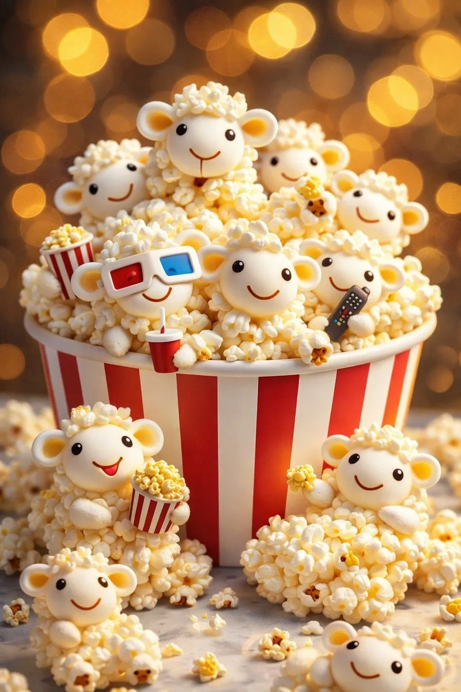

# ShaHid WaNii — by @meng_dagg695

[← Back to Community Examples](../../EXAMPLES.md) · Category: Illustration & 3D · Model: `Nano Banana`

<a href="https://x.com/meng_dagg695/status/2015256585984176226"></a>

Source: **[@meng_dagg695 on X](https://x.com/meng_dagg695/status/2015256585984176226)** · Creator: [ShaHid WaNii](https://x.com/meng_dagg695)

## Prompt

```text
{
  "global_settings": {
    "resolution": "8K ultra high definition",
    "aspect_ratio": "3:4 vertical",
    "image_quality": "extreme detail, ultra sharp focus",
    "lighting_style": "warm cinematic lighting with golden bokeh background",
    "depth_of_field": "shallow depth of field, strong subject separation",
    "render_style": "AI-edited, hyper-detailed, photorealistic with stylized realism",
    "color_grading": "warm tones, golden highlights, soft shadows",
    "background": "out-of-focus golden circular bokeh lights"
  },

  "Module_1_Image_1_Style": {
    "subject": "Cat-shaped tortilla chips",
    "primary_container": {
      "type": "red paper snack bag",
      "design": "large illustrated cartoon cat on front",
      "graphics": "simple facial features, soft pastel tones",
      "material": "matte paper texture"
    },
    "chip_details": {
      "shape": "cat heads with pointed ears",
      "color": "golden-orange fried texture",
      "surface": "crispy, bubbled, slightly uneven",
      "facial_features": {
        "eyes": "small black circular dots",
        "mouth": "simple curved line",
        "whiskers": "thin dark lines"
      }
    },
    "poses_and_interactions": {
      "one_chip": "holding a miniature cheeseburger",
      "one_chip": "holding a red-and-white striped soda cup with straw",
      "one_chip": "holding a triangular cheese slice",
      "foreground_chips": "sitting outside the bag on surface"
    },
    "composition": {
      "camera_angle": "slightly above eye level",
      "framing": "tight vertical framing",
      "focus": "sharp on chips, blurred background"
    }
  },

  "Module_2_Image_2_Style": {
    "subject": "Sheep-shaped popcorn figures",
    "primary_container": {
      "type": "classic popcorn bucket",
      "design": "red and white vertical stripes",
      "material": "cardboard with soft matte finish"
    },
    "sheep_details": {
      "body": "made entirely of popcorn kernels",
      "head": "smooth white rounded face",
      "ears": "small rounded ears with pale yellow inner tone",
      "eyes": "tiny black dots",
      "mouth": "thin curved smile line"
    },
    "poses_and_accessories": {
      "one_sheep": "wearing red-blue 3D glasses",
      "one_sheep": "holding a small popcorn bucket",
      "one_sheep": "holding a black TV remote",
      "multiple_sheep": "peeking from behind popcorn pile"
    },
    "composition": {
      "layering": "sheep stacked and clustered",
      "foreground": "extra popcorn scattered around base",
      "focus": "central sheep in sharp focus"
    }
  },

  "Module_3_Image_3_Style": {
    "subject": "Bear-shaped chicken popcorn nuggets",
    "primary_container": {
      "type": "white popcorn-style bucket",
      "branding": "text reads 'Chicken Popcorn'",
      "graphics": "simple chef hat icon above text",
      "decoration": "small colored polka dots"
    },
    "nugget_details": {
      "shape": "teddy bear silhouettes",
      "color": "golden-brown fried coating",
      "texture": "crunchy breaded surface",
      "facial_features": {
        "eyes": "small black beads",
        "nose": "rounded black nose",
        "mouth": "tiny dark line"
      }
    },
    "poses_and_accessories": {
      "one_nugget": "wearing black sunglasses",
      "one_nugget": "holding fries in red-striped cup",
      "one_nugget": "holding soda cup with straw",
      "foreground_nuggets": "standing outside bucket"
    },
    "composition": {
      "camera_distance": "medium close-up",
      "bucket_position": "centered vertically",
      "lighting": "warm highlights emphasizing texture''
```

## Try it

Paste the prompt into **[vinano.ai](https://vinano.ai?utm_source=github&utm_medium=readme&utm_campaign=awesome-image-video-prompts-updating&utm_content=x-page-try)** to generate your own version.

> The image and prompt belong to @meng_dagg695 ([original post](https://x.com/meng_dagg695/status/2015256585984176226)) and are shown here with credit for reference. Creators can ask for changes or removal by opening an issue.
