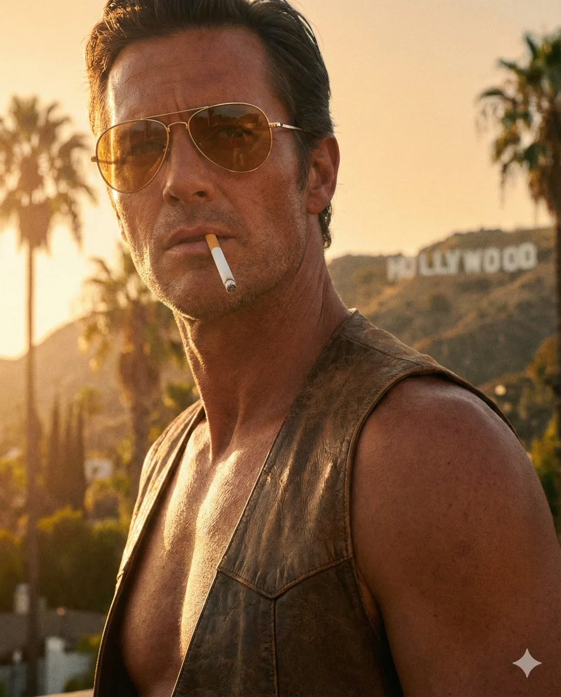

# Kaan — by @kaanakz

[← Back to Examples from X](../../EXAMPLES.md) · Category: Photography · Model: `Nano Banana`

<a href="https://x.com/kaanakz/status/2019797008110825959"></a>

Original post: **[@kaanakz on X](https://x.com/kaanakz/status/2019797008110825959)** · Creator: [Kaan](https://x.com/kaanakz)

## Prompt

```text
Shirtless male subject, hyper-realistic skin texture, deep tan, 1970s Hollywood aesthetic, vintage gold-rimmed aviator sunglasses with amber tint, unlit cigarette held in mouth, masculine ruggedness, medium close-up, low-angle perspective, background of blurred palm trees and hazy Los Angeles hillside, high-key natural sunlight, warm tungsten glow, golden hour color grading, shot on 35mm film, Arriflex 35 BL, 50mm T1.3, heavy film grain, authentic Kodak Portra 400 stock, slight lens flare, sun-bleached highlights, retro film-still style, directed by Quentin Tarantino
```

## Try it

Paste the prompt into **[vinano.ai](https://vinano.ai?utm_source=github&utm_medium=readme&utm_campaign=awesome-image-video-prompts-updating&utm_content=x-page-try)** to generate your own version.

> The image and prompt belong to [@kaanakz](https://x.com/kaanakz) and are shown here with credit for reference. Creators can ask for changes or removal by opening an issue.
