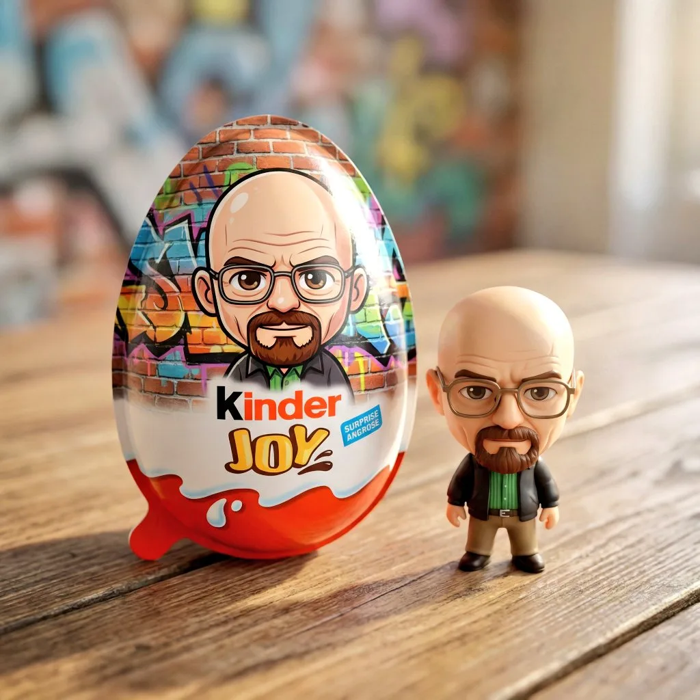

# WasifAI — by @doctorwasif

[← Back to Community Examples](../../EXAMPLES.md) · Category: Illustration & 3D · Model: `Nano Banana`

<a href="https://x.com/doctorwasif/status/2037393068538679624"></a>

Source: **[@doctorwasif on X](https://x.com/doctorwasif/status/2037393068538679624)** · Creator: [WasifAI](https://x.com/doctorwasif)

## Prompt

```text
A hyper-realistic product photo of a Kinder Joy surprise egg sitting on a wooden table. The egg packaging features a chibi/cartoon-style illustration of [image Uploaded] posed against a graffiti brick wall background. Next to the egg sits a small detailed collectible figurine of [image Uploaded] in the same chibi art style shown on the packaging. Soft natural lighting, shallow depth of field, photorealistic quality.
```

## Try it

Paste the prompt into **[vinano.ai](https://vinano.ai?utm_source=github&utm_medium=readme&utm_campaign=awesome-image-video-prompts-updating&utm_content=x-page-try)** to generate your own version.

> The image and prompt belong to @doctorwasif ([original post](https://x.com/doctorwasif/status/2037393068538679624)) and are shown here with credit for reference. Creators can ask for changes or removal by opening an issue.
