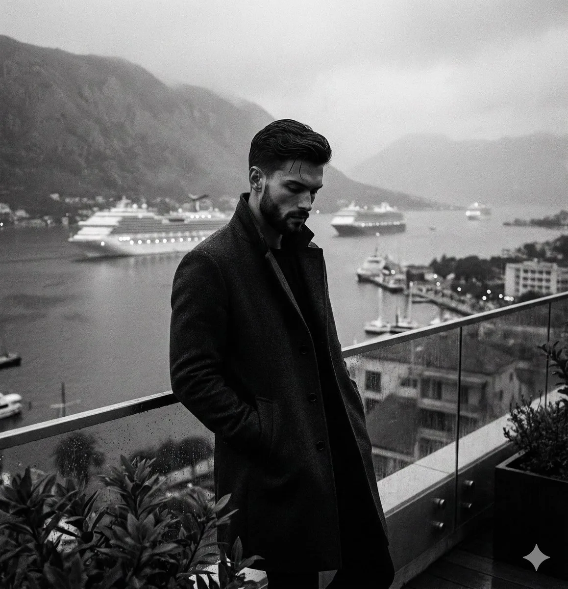

# Picts by AI — by @pictsbyai

[← Back to Community Examples](../../EXAMPLES.md) · Category: Photography · Model: `Nano Banana`

<a href="https://x.com/pictsbyai/status/2031053123196694930"></a>

Source: **[@pictsbyai on X](https://x.com/pictsbyai/status/2031053123196694930)** · Creator: [Picts by AI](https://x.com/pictsbyai)

## Prompt

```text
{
"metadata": {
"image_type": "photograph",
"primary_purpose": "editorial"
},
"composition": {
"rule_applied": "rule of thirds",
"aspect_ratio": "1:1",
"layout": "layered",
"focal_points": [
"Man in dark overcoat standing on the right side of the frame",
"Illuminated cruise ships floating in the misty bay"
],
"visual_hierarchy": "Eye starts on the dark, high-contrast figure of the man on the right, follows his downward gaze, then moves left across the glass railing to the textured plant, and finally drifts up to the illuminated ships and hazy mountains in the background",
"balance": "asymmetric"
},
"color_profile": {
"dominant_colors": [
{
"color": "Black",
"hex": "#0D0D0D",
"percentage": "25",
"role": "primary subject and foreground silhouettes"
},
{
"color": "Mid Gray",
"hex": "#808080",
"percentage": "45",
"role": "background bay, sky, and mountains"
},
{
"color": "Light Gray",
"hex": "#D3D3D3",
"percentage": "30",
"role": "fog, sky highlights, and water reflections"
}
],
"color_palette": "monochromatic",
"temperature": "cool",
"saturation": "black and white",
"contrast": "high contrast"
},
"lighting": {
"type": "natural window",
"source_count": "single source",
"direction": "diffused from above",
"directionality": "diffused",
"quality": "soft light",
"intensity": "moody",
"contrast_ratio": "high contrast (dramatic shadows)",
"mood": "mysterious",
"shadows": {
"type": "soft gradual edges",
"density": "deep black",
"placement": "under subject, obscuring facial details and coat folds",
"length": "short"
},
"highlights": {
"treatment": "subtle",
"placement": "on the water surface, ship lights, and plant leaves"
},
"ambient_fill": "present",
"light_temperature": "neutral"
},
"technical_specs": {
"medium": "digital photography",
"style": "realistic",
"texture": "grainy",
"sharpness": "slightly soft",
"grain": "film grain",
"depth_of_field": "deep",
"perspective": "straight on"
},
"artistic_elements": {
"genre": "portrait",
"influences": [
"Cinematic noir",
"Melancholic travel photography"
],
"mood": "calm",
"atmosphere": "Quiet, contemplative, slightly melancholic morning or evening with heavy atmospheric mist",
"visual_style": "minimal"
},
"typography": {
"present": false,
"fonts": [],
"placement": "none",
"integration": "subtle"
},
"subject_analysis": {
"primary_subject": "A man wearing a long dark overcoat and dress shoes, looking downward in thought",
"positioning": "right",
"scale": "environmental",
"interaction": "interacting with environment",
"facial_expression": {
"mouth": "closed smile",
"smile_intensity": "no smile",
"eyes": "looking away",
"eyebrows": "neutral",
"overall_emotion": "serious",
"authenticity": "candid"
},
"hands_and_gestures": {
"left_hand": "in pocket",
"right_hand": "in pocket",
"finger_positions": "relaxed",
"finger_interlacing": "none",
"hand_tension": "relaxed",
"interaction": "resting inside coat pockets",
"naturalness": "organic casual gesture"
},
"body_positioning": {
"posture": "leaning",
"angle": "45 degree turn",
"weight_distribution": "leaning right",
"shoulders": "relaxed"
}
},
"background": {
"setting_type": "outdoor",
"spatial_depth": "deep",
"elements_detailed": [
{
"item": "Glass balcony railing with metal handrail",
"position": "center",
"distance": "midground",
"size": "dominant",
"condition": "pristine",
"specific_features": "Transparent panels running horizontally across the frame"
},
{
"item": "Potted leafy shrub",
"position": "bottom left",
"distance": "foreground",
"size": "medium",
"condition": "thriving",
"specific_features": "Dense, small leaves catching subtle highlight reflections"
},
{
"item": "Smooth cylindrical planter pot",
"position": "bottom right",
"distance": "foreground",
"size": "small",
"condition": "pristine",
"specific_features": "Minimalist matte finish, containing another plant"
},
{
"item": "Illuminated cruise ships",
"position": "center",
"distance": "background",
"size": "small",
"condition": "pristine",
"specific_features": "Bright deck lights piercing through the fog"
},
{
"item": "Coastal mountains/hills",
"position": "top",
"distance": "background",
"size": "dominant",
"condition": "weathered",
"specific_features": "Silhouetted and hazy due to thick atmospheric fog"
}
],
"wall_surface": {
"material": "glass and metal",
"surface_treatment": "smooth",
"texture": "perfectly smooth",
"finish": "glossy",
"color": "transparent with gray reflections",
"color_variation": "gradient",
"features": "clean, modern architectural lines",
"wear_indicators": "pristine"
},
"floor_surface": {
"material": "tile",
"color": "mid-gray",
"pattern": "solid rectangular panels with distinct grout lines"
},
"objects_catalog": "Glass railing (midground horizontal), large leafy potted plant (bottom left foreground), sleek light-colored planter pot (bottom right foreground), three illuminated cruise ships (background bay), distant coastal town buildings (background right)",
"background_treatment": "gradient"
},
"generation_parameters": {
"prompts": [
"Cinematic black and white photograph of a man in a dark overcoat leaning against a modern glass balcony railing. He is positioned on the right, looking down thoughtfully with his hands in his pockets. In the background, a moody, fog-covered bay with large illuminated cruise ships and hazy mountains. Deep atmospheric perspective, film grain, soft diffused lighting, melancholic mood.",
"A moody monochromatic shot from a high-end coastal balcony. A silhouetted male figure stands resting against the glass barrier. Dense fog over a calm sea, dotted with the glowing lights of several distant ships. Potted plants frame the bottom corners. Melancholic, minimalist, rich gray tones, Leica photography style."
],
"keywords": [
"black and white",
"moody",
"fog",
"overcoat",
"balcony",
"cruise ships",
"cinematic",
"contemplative"
],
"technical_settings": "ISO 400, f/5.6 to maintain background visibility while keeping subject sharp, shutter speed 1/125s, shot on a medium focal length (e.g., 50mm).",
"post_processing": "Converted to monochrome, contrast adjusted to create a strong silhouette for the subject while maintaining soft midtones in the foggy background, added subtle film grain for texture."
}
}
```

## Try it

Paste the prompt into **[vinano.ai](https://vinano.ai?utm_source=github&utm_medium=readme&utm_campaign=awesome-image-video-prompts-updating&utm_content=x-page-try)** to generate your own version.

> The image and prompt belong to @pictsbyai ([original post](https://x.com/pictsbyai/status/2031053123196694930)) and are shown here with credit for reference. Creators can ask for changes or removal by opening an issue.
