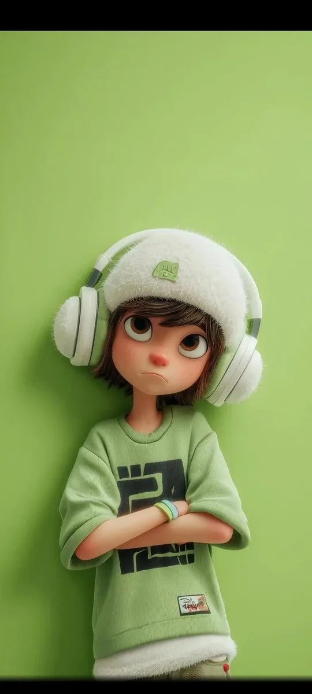

# auqib — by @auqibhabib

[← Back to Examples from X](../../EXAMPLES.md) · Category: Illustration & 3D · Model: `Nano Banana`

<a href="https://x.com/auqibhabib/status/2040674336605114412"></a>

Original post: **[@auqibhabib on X](https://x.com/auqibhabib/status/2040674336605114412)** · Creator: [auqib](https://x.com/auqibhabib)

## Prompt

```text
A stylized 3D cartoon character of a young boy with big expressive eyes and a slightly sad, pouty expression, standing against a solid pastel green background. He is wearing a soft white fuzzy beanie with ear flaps and matching white over-ear headphones. His hair is short, brown, and slightly messy, peeking out from under the cap. He wears an oversized light green t-shirt with a bold black graphic on the front, and his arms are crossed in a bored or annoyed pose. The lighting is soft, diffused studio lighting with smooth shadows, giving a clean aesthetic. Ultra-detailed, high-quality 3D render, Pixar-style, soft textures, shallow depth of field, centered composition, minimal background, vibrant but soft color palette.

Negative prompt (optional):
blurry, low quality, extra limbs, distorted face, harsh shadows, cluttered background, text artifacts, watermark
```

## Try it

Paste the prompt into **[vinano.ai](https://vinano.ai?utm_source=github&utm_medium=readme&utm_campaign=awesome-image-video-prompts-updating&utm_content=x-page-try)** to generate your own version.

> The image and prompt belong to [@auqibhabib](https://x.com/auqibhabib) and are shown here with credit for reference. Creators can ask for changes or removal by opening an issue.
