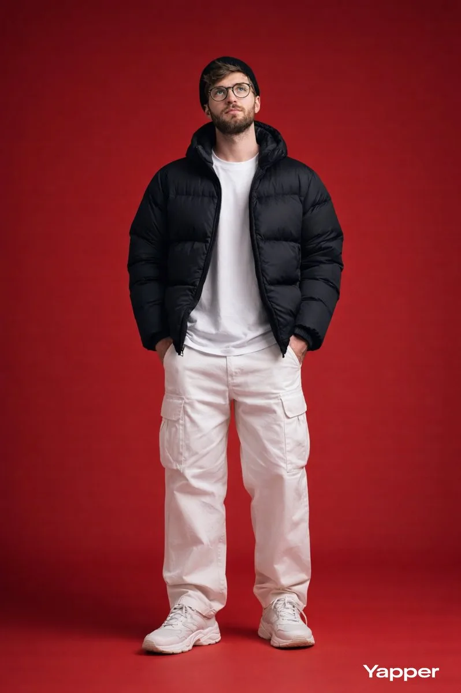

# Duet | AI — by @Sheldon056

[← Back to Examples from X](../../EXAMPLES.md) · Category: Photography · Model: `Nano Banana`

<a href="https://x.com/Sheldon056/status/2030793768195244295"></a>

Original post: **[@Sheldon056 on X](https://x.com/Sheldon056/status/2030793768195244295)** · Creator: [Duet | AI](https://x.com/Sheldon056)

## Prompt

```text
Ultra-realistic full-body studio fashion portrait of a stylish young man standing confidently, looking slightly upward. He wears a black puffer jacket, white t-shirt, loose white cargo pants, and chunky white sneakers. Accessories include round clear glasses and a black knit beanie. Hands in pockets, relaxed confident posture. Clean seamless solid red studio background. Soft professional studio lighting, sharp clothing texture, editorial fashion photography.
```

## Try it

Paste the prompt into **[vinano.ai](https://vinano.ai?utm_source=github&utm_medium=readme&utm_campaign=awesome-image-video-prompts-updating&utm_content=x-page-try)** to generate your own version.

> The image and prompt belong to [@Sheldon056](https://x.com/Sheldon056) and are shown here with credit for reference. Creators can ask for changes or removal by opening an issue.
