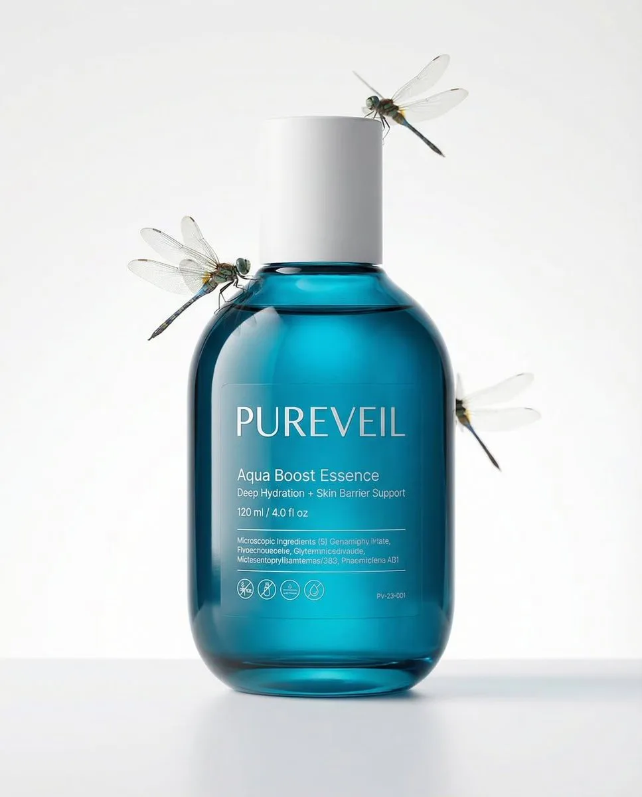

# K — by @ChillaiKalan__

[← Back to Community Examples](../../EXAMPLES.md) · Category: Product & Brand · Model: `Nano Banana`

<a href="https://x.com/ChillaiKalan__/status/2039599784173195358"></a>

Source: **[@ChillaiKalan__ on X](https://x.com/ChillaiKalan__/status/2039599784173195358)** · Creator: [K](https://x.com/ChillaiKalan__)

## Prompt

```text
A professional skincare shot of a [product container] with [cap/lid], labeled [brand, product, descriptor, volume] with [foil/ink/embossing]. [Number] [animal type(s)] in [colors] are arranged [positions/actions] around it. [Held/placed/floating] naturally. Clean white background, soft shadow, bright lighting, ultra-high resolution, 8k, professional cosmetic photography.
```

## Try it

Paste the prompt into **[vinano.ai](https://vinano.ai?utm_source=github&utm_medium=readme&utm_campaign=awesome-image-video-prompts-updating&utm_content=x-page-try)** to generate your own version.

> The image and prompt belong to @ChillaiKalan__ ([original post](https://x.com/ChillaiKalan__/status/2039599784173195358)) and are shown here with credit for reference. Creators can ask for changes or removal by opening an issue.
