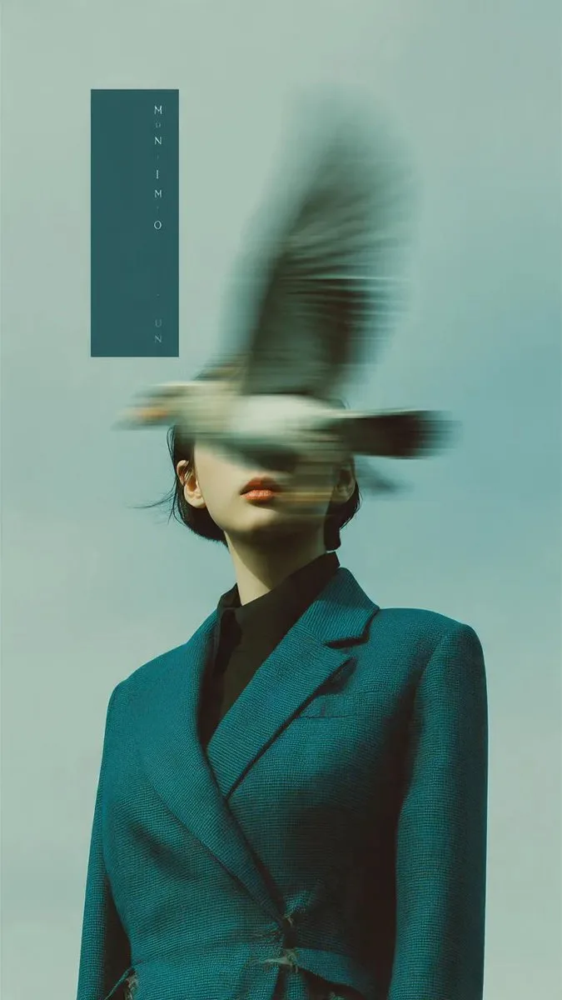

# K — by @ChillaiKalan__

[← Back to Community Examples](../../EXAMPLES.md) · Category: Poster Design · Model: `Nano Banana`

<a href="https://x.com/ChillaiKalan__/status/2029072361669181640"></a>

Source: **[@ChillaiKalan__ on X](https://x.com/ChillaiKalan__/status/2029072361669181640)** · Creator: [K](https://x.com/ChillaiKalan__)

## Prompt

```text
Editorial photography, a woman wearing a structured deep teal blazer standing against a pale blue sky. A bird in heavy motion blur is flying across her face, obscuring her features, surrealist style. High-grain paper texture, cinematic soft lighting, minimalist composition. Magazine cover aesthetic with a clean white vertical sidebar on the left containing bold black typography. Muted cool tones, artistic blur, 35mm film aesthetic, avant-garde fashion vibe
```

## Try it

Paste the prompt into **[vinano.ai](https://vinano.ai?utm_source=github&utm_medium=readme&utm_campaign=awesome-image-video-prompts-updating&utm_content=x-page-try)** to generate your own version.

> The image and prompt belong to @ChillaiKalan__ ([original post](https://x.com/ChillaiKalan__/status/2029072361669181640)) and are shown here with credit for reference. Creators can ask for changes or removal by opening an issue.
