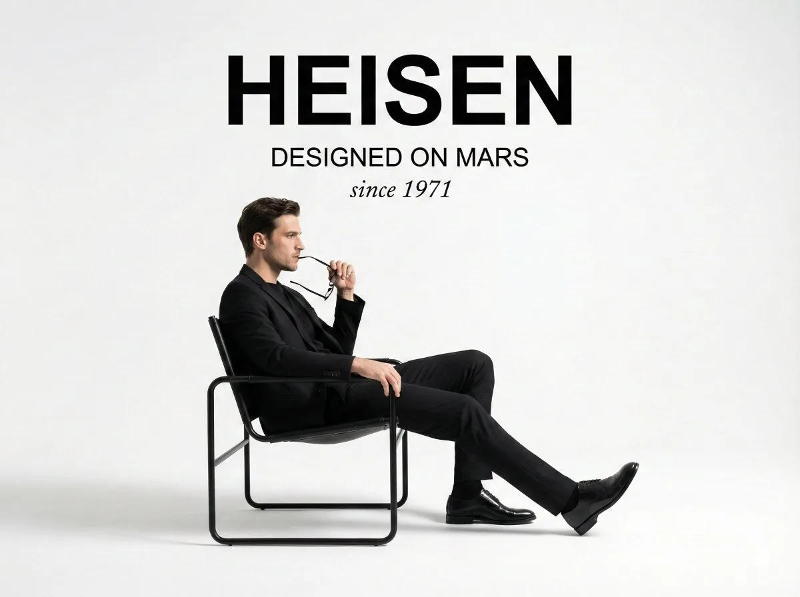

# Heisenberg — by @rovvmut_

[← Back to Examples from X](../../EXAMPLES.md) · Category: Photography · Model: `Nano Banana`

<a href="https://x.com/rovvmut_/status/2011320913908941188"></a>

Original post: **[@rovvmut_ on X](https://x.com/rovvmut_/status/2011320913908941188)** · Creator: [Heisenberg](https://x.com/rovvmut_)

## Prompt

```text
A minimalist studio photograph fashion ad. At the top center, the bold sans-serif text "[TEXT]" is positioned above the smaller sans-serif text "[TEXT]", which is above the italic script text "[TEXT]". Below the text, a man in a black suit, black t-shirt, and polished black dress shoes sits in profile, facing left. He is seated in a modern chair with a black leather seat and backrest suspended on a tubular black metal frame. His right leg is extended, and he holds a pair of glasses in his right hand near his mouth. The background and floor are a seamless, stark white studio space with soft, diffused lighting that casts grounded shadows beneath the man and chair.
```

## Try it

Paste the prompt into **[vinano.ai](https://vinano.ai?utm_source=github&utm_medium=readme&utm_campaign=awesome-image-video-prompts-updating&utm_content=x-page-try)** to generate your own version.

> The image and prompt belong to [@rovvmut_](https://x.com/rovvmut_) and are shown here with credit for reference. Creators can ask for changes or removal by opening an issue.
