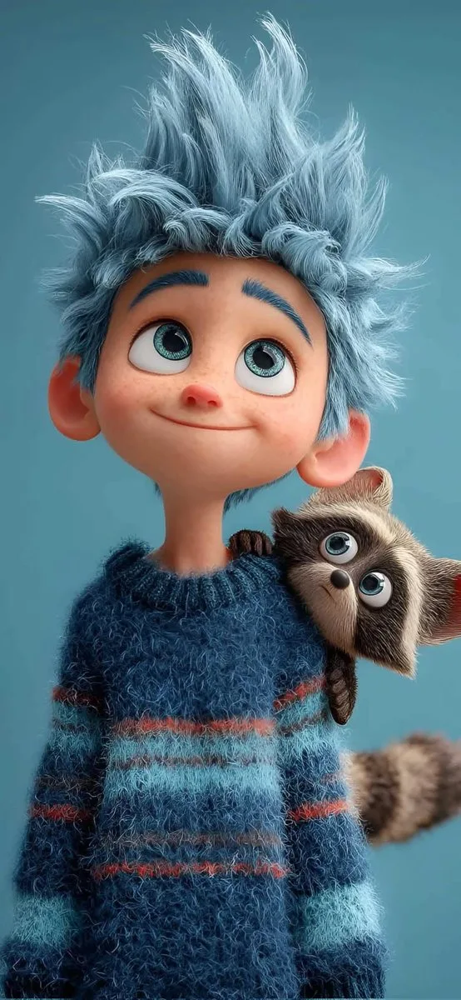

# Taaruk — by @Taaruk_

[← Back to Community Examples](../../EXAMPLES.md) · Category: Illustration & 3D · Model: `Nano Banana`

<a href="https://x.com/Taaruk_/status/2029567508244750343"></a>

Source: **[@Taaruk_ on X](https://x.com/Taaruk_/status/2029567508244750343)** · Creator: [Taaruk](https://x.com/Taaruk_)

## Prompt

```text
Cute stylized 3D animated boy with messy fluffy blue hair and big expressive eyes, soft freckles on face, wearing a fuzzy blue striped sweater, small adorable raccoon sitting on his shoulder, looking upward with a gentle smile, Pixar-style character design, soft studio lighting, pastel blue background, ultra-detailed fur and fabric texture, cinematic portrait composition, high-quality 3D render, 8K.
```

## Try it

Paste the prompt into **[vinano.ai](https://vinano.ai?utm_source=github&utm_medium=readme&utm_campaign=awesome-image-video-prompts-updating&utm_content=x-page-try)** to generate your own version.

> The image and prompt belong to @Taaruk_ ([original post](https://x.com/Taaruk_/status/2029567508244750343)) and are shown here with credit for reference. Creators can ask for changes or removal by opening an issue.
