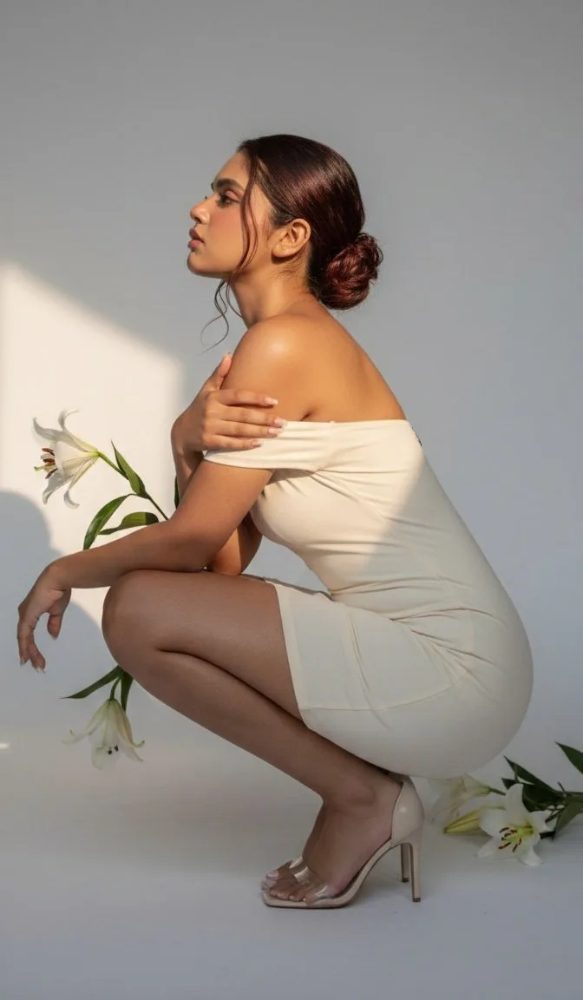

# Dr. Samia — by @oye_samia

[← Back to Examples from X](../../EXAMPLES.md) · Category: Photography · Model: `Nano Banana`

<a href="https://x.com/oye_samia/status/2024027461520937070"></a>

Original post: **[@oye_samia on X](https://x.com/oye_samia/status/2024027461520937070)** · Creator: [Dr. Samia](https://x.com/oye_samia)

## Prompt

```text
Role: high-end fashion editorial photographer shooting a luxury minimalist studio campaign, ultra-realistic photography
Subject: use the attached face photo as the exact facial identity (100% identity preservation, anatomical precision, original proportions, natural skin texture, no AI beautification, no facial reshaping), seamlessly replace the model's face from the reference image with the attached face, perfect alignment of jawline, cheekbones, eye spacing, nose structure, skin tone matching and lighting consistency, no visible blending artifacts
Body Adjustment: slightly slimmer silhouette, more refined waistline, subtly leaner arms and thighs, elegant elongated body proportions, natural anatomy preserved (no distortion), realistic bone structure and muscle definition
Pose & Composition (match reference exactly): deep squat pose, body in full side profile, torso leaning slightly forward, one arm wrapped across chest holding opposite shoulder, other arm extended forward holding a single white lily, head lifted slightly upward, lips relaxed (natural neutral expression, no pursed lips, no blowing expression), elegant elongated neck posture, full body visible within frame, minimalistic light grey seamless studio background, soft diagonal shadow on background and floor
Outfit (exact replication): cream/off-white fitted long-sleeve dress, asymmetrical off-shoulder neckline, exposed upper back and shoulders, soft stretch fabric tightly fitted to body, natural fabric tension and realistic fold compression at knees and waist, floor-length hem, no necklace, delicate drop earrings, clean natural manicure
Hair (match styling exactly): low textured bun, soft loose face-framing tendrils, elegant romantic styling, natural volume, subtle shine
Makeup (exact replication): neutral glam makeup, matte skin with soft highlight, subtle contour, defined brows, soft brown smoky eye, nude lips (relaxed natural shape, not puckered), refined editorial finish
Props (must match exactly): single white lily held in extended hand, additional lilies placed on floor behind, realistic botanical detail, accurate leaf texture, natural stem structure, correct shadow interaction with floor
Lighting & Realism: professional studio lighting, soft directional key light from left side, smooth shadow gradient, high dynamic range, ultra high resolution, sharp focus on eyes, realistic skin pores, accurate fabric physics with natural stretch and compression, realistic floor reflections, no plastic skin, no oversmoothing
Camera: full-frame camera, 85mm lens, shallow depth of field, luxury fashion editorial color grading, clean neutral tones
Negative prompt: low resolution, distorted face, incorrect anatomy, exaggerated thinness, unhealthy body proportions, asymmetry errors, extra limbs, warped hands, artificial skin texture, over-smoothed skin, wrong dress style, different color dress, added jewelry, incorrect flowers, wrong pose, different background, harsh lighting, blurry eyes, visible face merge artifacts, AI look, cartoonish rendering, oversaturated colors.
```

## Try it

Paste the prompt into **[vinano.ai](https://vinano.ai?utm_source=github&utm_medium=readme&utm_campaign=awesome-image-video-prompts-updating&utm_content=x-page-try)** to generate your own version.

> The image and prompt belong to [@oye_samia](https://x.com/oye_samia) and are shown here with credit for reference. Creators can ask for changes or removal by opening an issue.
