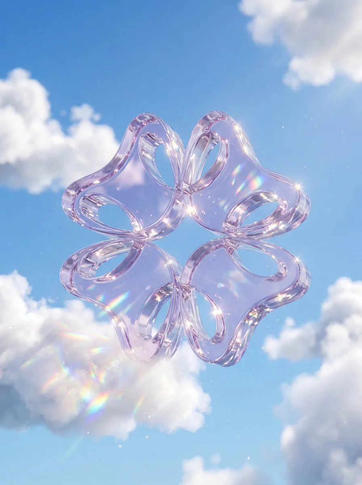

# Zazzy — by @zazzygfx

[← Back to Community Examples](../../EXAMPLES.md) · Category: Illustration & 3D · Model: `Nano Banana`

<a href="https://x.com/zazzygfx/status/2043753023004954753"></a>

Source: **[@zazzygfx on X](https://x.com/zazzygfx/status/2043753023004954753)** · Creator: [Zazzy](https://x.com/zazzygfx)

## Prompt

```text
A premium 3D stylized version of attached logo, rendered as thick, translucent crystal glass with high refraction. The object is floating amidst fluffy, realistic white cumulus clouds against a bright, clear blue sky. Soft natural sunlight creates bright caustic reflections and rainbow dispersion within the glass. Ethereal, airy, and highly polished 3D aesthetic
```

## Try it

Paste the prompt into **[vinano.ai](https://vinano.ai?utm_source=github&utm_medium=readme&utm_campaign=awesome-image-video-prompts-updating&utm_content=x-page-try)** to generate your own version.

> The image and prompt belong to @zazzygfx ([original post](https://x.com/zazzygfx/status/2043753023004954753)) and are shown here with credit for reference. Creators can ask for changes or removal by opening an issue.
