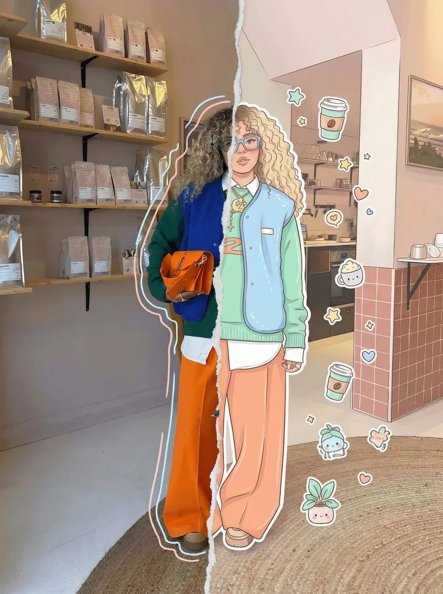

# Ciri — by @Ciri_ai

[← Back to Community Examples](../../EXAMPLES.md) · Category: Illustration & 3D · Model: `Nano Banana`

<a href="https://x.com/Ciri_ai/status/2040118989775585520"></a>

Source: **[@Ciri_ai on X](https://x.com/Ciri_ai/status/2040118989775585520)** · Creator: [Ciri](https://x.com/Ciri_ai)

## Prompt

```text
High-detail 8K split-style composition where the subject is divided vertically into two halves.
LEFT SIDE:
Keep the original photo fully realistic. Preserve natural lighting, textures, and fine details. Slightly enhance sharpness and clarity. Add subtle hand-drawn doodle outlines (soft pastel or neon lines) around the subject for a creative aura.
RIGHT SIDE:
Transform the same subject into a stylized cartoon/digital illustration. Maintain the exact same pose, angle, and facial expression. Use clean lineart, soft shading, and pastel or vibrant colors in a modern cute style (chibi / semi-realistic). Add small decorative elements like sticker-style doodles, cute icons, or mini characters floating around.
BACKGROUND (IMPORTANT):
Keep the ORIGINAL background unchanged on BOTH sides. Do not replace, redraw, or stylize the background. Maintain consistency across the entire image.
CENTER DIVISION:
Add a vertical torn-paper or glitch-style transition separating the realistic and illustrated halves.
STYLE:
modern digital art, clean composition, soft lighting, aesthetically pleasing, social media style
QUALITY: 8K resolution, ultra-detailed.
```

## Try it

Paste the prompt into **[vinano.ai](https://vinano.ai?utm_source=github&utm_medium=readme&utm_campaign=awesome-image-video-prompts-updating&utm_content=x-page-try)** to generate your own version.

> The image and prompt belong to @Ciri_ai ([original post](https://x.com/Ciri_ai/status/2040118989775585520)) and are shown here with credit for reference. Creators can ask for changes or removal by opening an issue.
