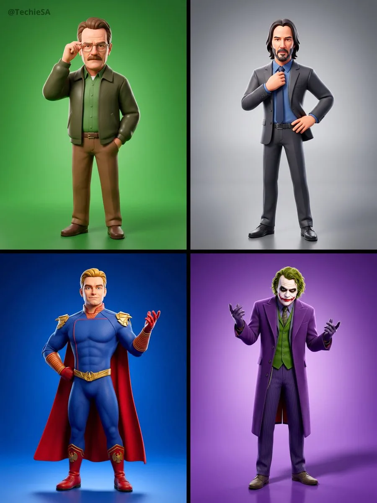

# TechieSA — by @TechieBySA

[← Back to Community Examples](../../EXAMPLES.md) · Category: Illustration & 3D · Model: `Nano Banana`

<a href="https://x.com/TechieBySA/status/2033873251777044747"></a>

Source: **[@TechieBySA on X](https://x.com/TechieBySA/status/2033873251777044747)** · Creator: [TechieSA](https://x.com/TechieBySA)

## Prompt

```text
Transform the referenced person into a premium stylized 3D animated character, full body hero shot, standing confidently in the exact center of the frame. Preserve the exact identity and key facial details as closely as possible, including face shape, eyes, nose, mouth, hairstyle, skin tone, and expression, without redesigning the face. Use soft rounded geometry, smooth polished materials, subtle glossy shading, and a modern premium 3D animation style. The pose must feel dynamic, charismatic, and heroic, not stiff. Let the arms and hands naturally perform an expressive gesture that best suits the character’s body shape, personality, and visual balance, chosen intelligently for the most flattering and appealing result. Keep the full body fully visible while the character still feels close, clear, and strongly present to the camera. Use a clean solid background or a soft gradient [BACKGROUND COLOR]. Studio-quality lighting, soft grounded shadow, strong subject separation, clean premium composition, ultra refined, highly detailed, no props, no text, no logos, no watermark
```

## Try it

Paste the prompt into **[vinano.ai](https://vinano.ai?utm_source=github&utm_medium=readme&utm_campaign=awesome-image-video-prompts-updating&utm_content=x-page-try)** to generate your own version.

> The image and prompt belong to @TechieBySA ([original post](https://x.com/TechieBySA/status/2033873251777044747)) and are shown here with credit for reference. Creators can ask for changes or removal by opening an issue.
