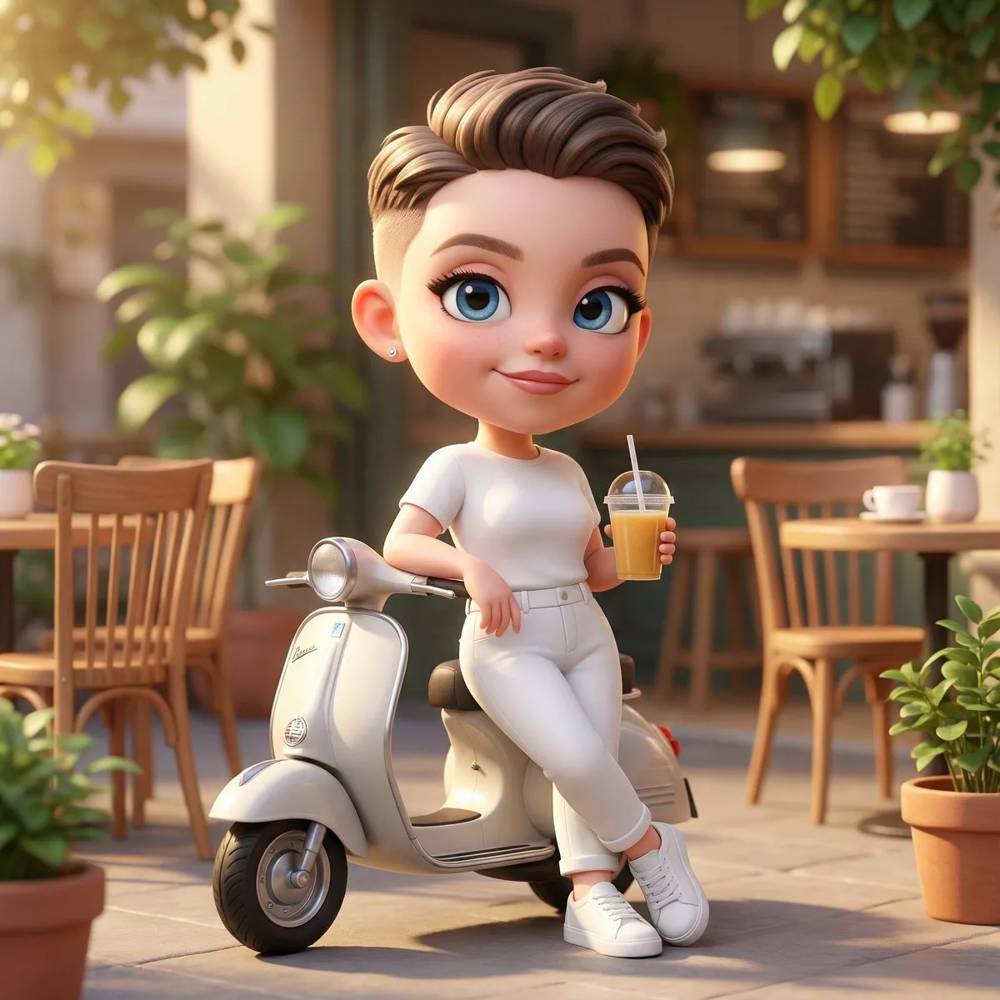

# Synthia — by @AIwithSynthia

[← Back to Examples from X](../../EXAMPLES.md) · Category: Illustration & 3D · Model: `Nano Banana`

<a href="https://x.com/AIwithSynthia/status/2012060251231822295"></a>

Original post: **[@AIwithSynthia on X](https://x.com/AIwithSynthia/status/2012060251231822295)** · Creator: [Synthia](https://x.com/AIwithSynthia)

## Prompt

```text
A cute 3D chibi-style character of the uploaded image leaning against a parked mini chibi scooter, wearing a clean monochrome outfit with a t-shirt, straight-fit pants, and minimalist sneakers, holding a takeaway juice cup with a relaxed confident smile, big head and expressive eyes, modern fade haircut, set in a cozy café courtyard with wooden chairs, warm golden sunlight, soft depth of field, pastel color palette, smooth rounded proportions, subtle texture detailing, global illumination with gentle rim light, soft natural shadows, playful yet premium Pixar-quality 3D render, toy-like finish, Google Gemini cinematic but cozy mood, ultra-clean high-detail output, Instagram-ready composition, square aspect ratio 1:1
```

## Try it

Paste the prompt into **[vinano.ai](https://vinano.ai?utm_source=github&utm_medium=readme&utm_campaign=awesome-image-video-prompts-updating&utm_content=x-page-try)** to generate your own version.

> The image and prompt belong to [@AIwithSynthia](https://x.com/AIwithSynthia) and are shown here with credit for reference. Creators can ask for changes or removal by opening an issue.
