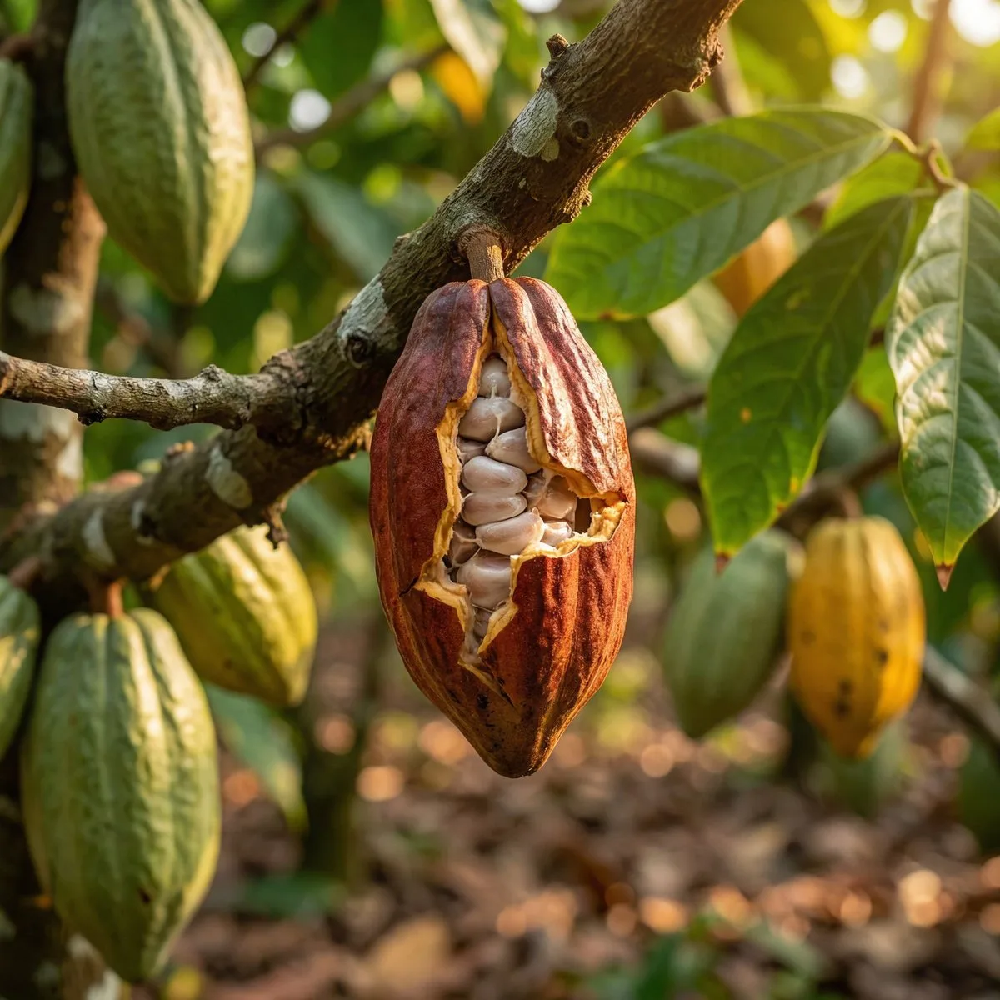

# Sharon Riley — by @Just_sharon7

[← Back to Examples from X](../../EXAMPLES.md) · Category: Photography · Model: `Nano Banana`

<a href="https://x.com/Just_sharon7/status/2015730476632474105"></a>

Original post: **[@Just_sharon7 on X](https://x.com/Just_sharon7/status/2015730476632474105)** · Creator: [Sharon Riley](https://x.com/Just_sharon7)

## Prompt

```text
High-quality realistic commercial shot of a cocoa plantation in landscape orientation, cocoa tree as background, one cocoa pod partially split open on the branch in the center, fresh cocoa beans clearly visible inside with fibrous natural texture, slight irregular opening, surrounding pods and leaves softly out of focus, rich earthy brown and green tones, warm natural daylight with soft directional highlights, shallow depth of field, premium agricultural realism, no text, no people, no branding.
```

## Try it

Paste the prompt into **[vinano.ai](https://vinano.ai?utm_source=github&utm_medium=readme&utm_campaign=awesome-image-video-prompts-updating&utm_content=x-page-try)** to generate your own version.

> The image and prompt belong to [@Just_sharon7](https://x.com/Just_sharon7) and are shown here with credit for reference. Creators can ask for changes or removal by opening an issue.
