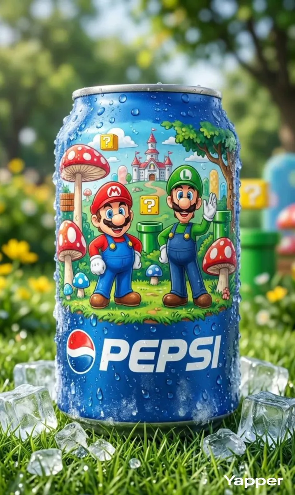

# Duet | AI — by @Sheldon056

[← Back to Examples from X](../../EXAMPLES.md) · Category: Illustration & 3D · Model: `Nano Banana`

<a href="https://x.com/Sheldon056/status/2028636305803051268"></a>

Original post: **[@Sheldon056 on X](https://x.com/Sheldon056/status/2028636305803051268)** · Creator: [Duet | AI](https://x.com/Sheldon056)

## Prompt

```text
Ultra-realistic product photography of a chilled blue Pepsi can placed upright on fresh green grass, covered with cold water droplets and condensation. Ice cubes scattered around the base. The can features a vibrant, colorful illustration of Mario and Luigi standing together in a whimsical mushroom kingdom scene with red and blue mushrooms, green pipes, question blocks, and a castle in the background. Bright, cheerful, cartoon-style artwork printed on the can.

Shot outdoors in natural daylight with a soft, blurred garden background (bokeh effect), bright green foliage and sunlight filtering through trees. Shallow depth of field, macro detail, high contrast, vivid colors, sharp focus on the can, cinematic product lighting, summer refreshment mood, commercial advertising style, ultra-detailed, 8K quality, photorealistic, centered composition, vertical framing.
```

## Try it

Paste the prompt into **[vinano.ai](https://vinano.ai?utm_source=github&utm_medium=readme&utm_campaign=awesome-image-video-prompts-updating&utm_content=x-page-try)** to generate your own version.

> The image and prompt belong to [@Sheldon056](https://x.com/Sheldon056) and are shown here with credit for reference. Creators can ask for changes or removal by opening an issue.
