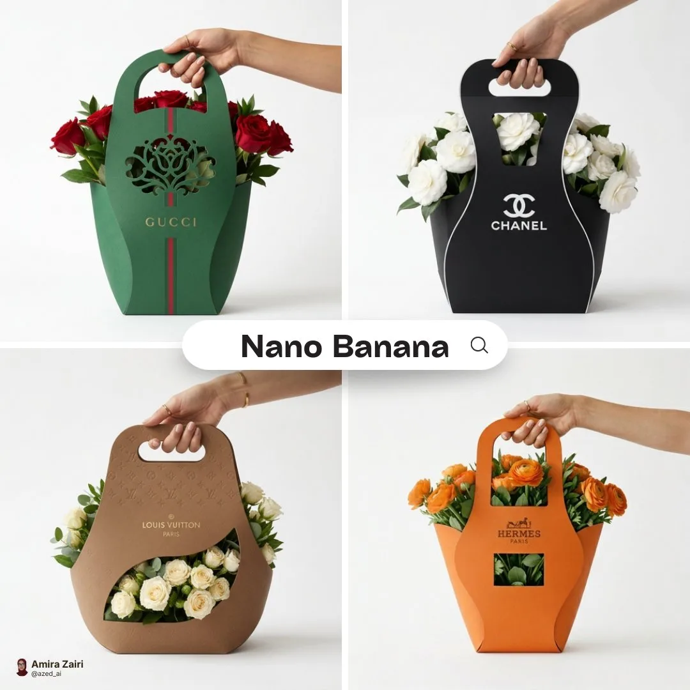

# Amira Zairi — by @azed_ai

[← Back to Community Examples](../../EXAMPLES.md) · Category: Product & Brand · Model: `Nano Banana`

<a href="https://x.com/azed_ai/status/2030282080945647687"></a>

Source: **[@azed_ai on X](https://x.com/azed_ai/status/2030282080945647687)** · Creator: [Amira Zairi](https://x.com/azed_ai)

## Prompt

```text
Minimalist branded flower packaging design for [brand], eco-friendly cardboard sleeve with integrated handle, sculptural curved silhouette wrapping naturally around a fresh bouquet, packaging fully designed using the official brand color palette, matte surface with the brand logo cleanly centered on the front panel, precision die-cut window integrated into the design allowing flowers to subtly emerge, cohesive color blocking aligned with brand identity, modern premium branding aesthetic, smooth paper texture, refined structural details, hand holding the package naturally, studio product photography, centered composition, pure white background, soft realistic contact shadow beneath, high-end packaging mockup, ultra-detailed, 1:1 aspect ratio.
```

## Try it

Paste the prompt into **[vinano.ai](https://vinano.ai?utm_source=github&utm_medium=readme&utm_campaign=awesome-image-video-prompts-updating&utm_content=x-page-try)** to generate your own version.

> The image and prompt belong to @azed_ai ([original post](https://x.com/azed_ai/status/2030282080945647687)) and are shown here with credit for reference. Creators can ask for changes or removal by opening an issue.
