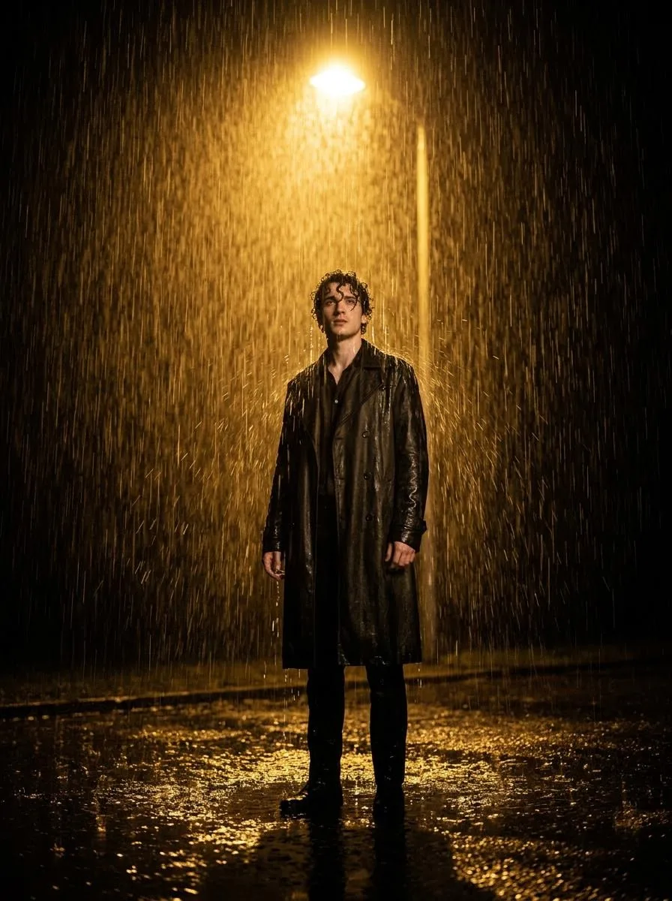

# Nikhil — by @NikhilRajX

[← Back to Examples from X](../../EXAMPLES.md) · Category: Photography · Model: `Nano Banana`

<a href="https://x.com/NikhilRajX/status/2036128381763461566"></a>

Original post: **[@NikhilRajX on X](https://x.com/NikhilRajX/status/2036128381763461566)** · Creator: [Nikhil](https://x.com/NikhilRajX)

## Prompt

```text
Create a highly cinematic, realistic photo of a person using the face from the uploaded image. The person is standing alone under a single streetlight at night in heavy rain. The rain is pouring down dramatically, with visible droplets and water splashing on the ground. The streetlight casts a strong golden glow, lighting only the person while the surroundings fade into darkness. The ground is wet and reflective, creating beautiful reflections of the light. The camera angle is slightly low and centered, giving a powerful, movie-like look. The person is wearing a dark stylish outfit like a long coat or jacket, with water dripping from clothes and hair. Their expression is calm and intense. Cinematic lighting, dramatic contrast, volumetric light rays through rain, ultra realistic photography, Hollywood movie scene, high detail, atmospheric depth.
```

## Try it

Paste the prompt into **[vinano.ai](https://vinano.ai?utm_source=github&utm_medium=readme&utm_campaign=awesome-image-video-prompts-updating&utm_content=x-page-try)** to generate your own version.

> The image and prompt belong to [@NikhilRajX](https://x.com/NikhilRajX) and are shown here with credit for reference. Creators can ask for changes or removal by opening an issue.
