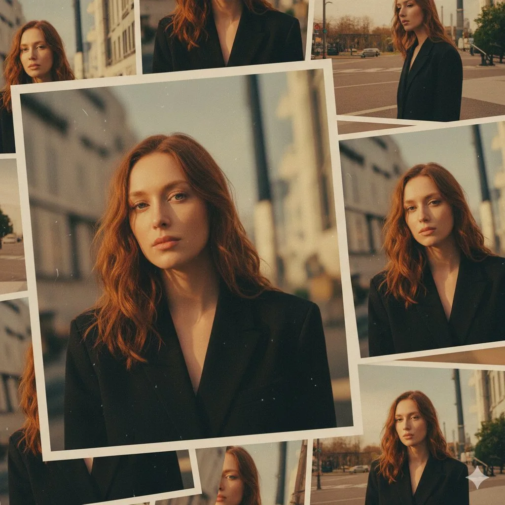

# Anissa — by @SimplyAnnisa

[← Back to Examples from X](../../EXAMPLES.md) · Category: Photography · Model: `Nano Banana`

<a href="https://x.com/SimplyAnnisa/status/2023762122853986641"></a>

Original post: **[@SimplyAnnisa on X](https://x.com/SimplyAnnisa/status/2023762122853986641)** · Creator: [Anissa](https://x.com/SimplyAnnisa)

## Prompt

```text
unlimited nano banana pro, AI photo collage, vintage film look, black and white editorial, cinematic , analog photography aesthetic, collage, film grain texture, Ilford HP5 style, moody portrait lighting, street photography vibe, retro zine layout, AI photography workflow, prompt sharing, generative art prompts, editorial collage design
```

## Try it

Paste the prompt into **[vinano.ai](https://vinano.ai?utm_source=github&utm_medium=readme&utm_campaign=awesome-image-video-prompts-updating&utm_content=x-page-try)** to generate your own version.

> The image and prompt belong to [@SimplyAnnisa](https://x.com/SimplyAnnisa) and are shown here with credit for reference. Creators can ask for changes or removal by opening an issue.
