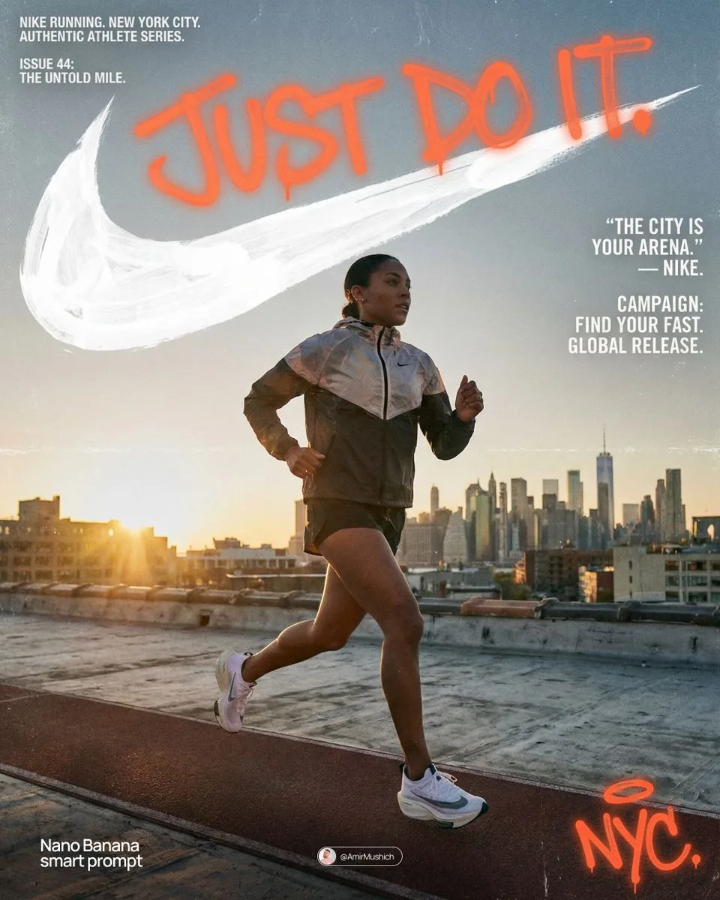

# AmirMušić — by @AmirMushich

[← Back to Community Examples](../../EXAMPLES.md) · Category: Poster Design · Model: `Nano Banana`

<a href="https://x.com/AmirMushich/status/2039795053237858362"></a>

Source: **[@AmirMushich on X](https://x.com/AmirMushich/status/2039795053237858362)** · Creator: [AmirMušić](https://x.com/AmirMushich)

## Prompt

```text
[BRAND NAME]

Act as a Senior Street Culture Art Director and Editorial Designer specializing in authentic underground magazine covers and campaign posters that feel documentary rather than commercial. Your reference universe: Thrasher Magazine, i-D, The Face, Dazed — raw, real, typographically bold.

BRAND INTELLIGENCE SYSTEM

Before executing, resolve: (1) HERO SUBJECT — identify the most authentic human archetype or iconic product moment associated with [BRAND NAME]'s world. Autonomously determine what this looks like based purely on the brand's identity — a person interacting with the brand's hero product in their most natural environment, or the hero product itself as the sole subject if no human archetype is more powerful. The subject must feel like it belongs to this brand's specific world — not borrowed from another brand's cultural universe. Never default to skateboarding, skating, or street sport unless [BRAND NAME] is specifically and primarily a skate brand, (2) ENVIRONMENT — the most iconic real-world location context for [BRAND NAME]'s subject — not a studio, always a real place with atmosphere: a rooftop, a street, a race track, a kitchen, a parking lot, a coastline, a salon, a garage, a runway, (3) BRAND WORDMARK STYLE — identify how [BRAND NAME]'s name would look rendered as a rough hand-painted or chalk brushstroke headline — the texture and character of the lettering must feel native to the brand's specific subculture and communication style, (4) NEON ACCENT COLOR — identify one single neon or highly saturated accent color that feels culturally connected to [BRAND NAME]'s world — this will be used exclusively for the graffiti tag overlay and nowhere else, (5) QUOTE LINE — autonomously generate a short authentic-sounding quote or phrase in [BRAND NAME]'s voice — 4–6 words, raw and real, not corporate, not generic.

PHASE 1: PHOTOGRAPHY BASE

The entire image is built on a real location photograph — not a studio shot, not a white background, not a cyclorama. The environment resolved in the brand intelligence system is the setting. Natural or available light only — no softboxes, no controlled studio lighting. The light should feel like it was taken at golden hour, overcast day, or in existing ambient conditions. Camera angle: dynamic and committed — low angle looking up for power, or a dramatic dutch tilt for tension, never flat eye-level. The subject is captured at peak energy — the single most alive frame of the action or moment. The photograph fills the entire canvas edge to edge with no padding. Color grade: slightly pushed contrast, natural colors preserved, filmic grain, not over-processed. This photograph must feel like it was taken by a photographer who was actually there — not staged, not art directed to death.

PHASE 2: BRAND LOGO BRUSHSTROKE — CRITICAL

Autonomously identify [BRAND NAME]'s primary icon mark or logo symbol — the exact recognizable shape  that represents this brand visually. Render this logo mark as a large hand-painted brushstroke version — as if a skilled street artist took a wide brush loaded with paint and painted the logo freehand on a wall. The shape must be immediately recognizable as [BRAND NAME]'s actual logo geometry — correct proportions, correct silhouette, correct internal details — but executed in a loose, gestural, brush-painted style with visible bristle marks, paint drips, slightly uneven edges, and areas where the paint is thinner and the surface shows through. This is not a clean vector trace — it is a human hand interpreting a logo with a brush. Size: enormous — spanning 70–85% of canvas width, occupying the upper third of the canvas. Color: white or off-white paint — reading clearly against the photograph behind it. The brushstroke logo sits on top of the photograph as an overlay with natural paint transparency in the thinner areas.

PHASE 3: GRAFFITI TAG OVERLAY

One single graffiti element in the NEON ACCENT COLOR resolved in the brand intelligence system. This element is a loose hand-drawn tag, throw-up, or marker scrawl — a secondary word, a symbol, an abstract mark, or a stylized brand-relevant word. It sits on top of everything — over the photograph, over the wordmark, over any other element — as if added last and spontaneously, like someone tagged the poster after it was printed. Placement: partially overlapping the brand wordmark in the upper portion of the image with additional marks or drips extending into the mid-section of the canvas. The neon accent color is used nowhere else in the entire composition — this element owns that color exclusively. The graffiti mark adds rawness and authenticity — it breaks the polish and makes the whole thing feel real.

PHASE 4: TYPOGRAPHY SYSTEM

Four distinct text zones — all small, all restrained, creating an editorial layout grid around the large wordmark and photograph. UPPER LEFT BLOCK: 3–4 lines of very small all-caps or mixed case body text describing [BRAND NAME]'s campaign, collection, or brand context — autonomously generate relevant editorial copy in [BRAND NAME]'s voice. This block sits in the top-left corner, justified left, at footnote scale. TWO LABEL LINES: directly below the upper left block — a campaign name or season on the left, a short descriptor on the right — both in small caps, same scale as body text. RIGHT MID BLOCK: the QUOTE LINE resolved in the brand intelligence system rendered in quotation marks in the right-center area, slightly larger than body text but still small relative to the wordmark. Below the quote: [BRAND NAME] in small caps as attribution. Below that: 3–4 lines of small body copy with [BRAND NAME]'s campaign message — autonomously generate relevant content. LOWER RIGHT DETAIL: a small secondary graffiti-style tag or signature mark in the neon accent color — smaller than the main graffiti element, positioned lower right as a finishing mark.

PHASE 5: OVERALL COMPOSITION

The visual hierarchy reads in this exact order: (1) the photograph and its energy — the eye enters through the action or subject, (2) the massive brushstroke wordmark — confirms the brand, (3) the neon graffiti tag — adds rawness and surprise, (4) the typography blocks — rewards closer reading. The composition must feel like a real magazine cover or a poster wheat-pasted on a wall — not a social media graphic, not a clean digital mockup. Every element has a reason to exist. Nothing is decorative. The rawness is the design.

TECH SPECS

Photography: real location, natural light, peak moment, filmic color grade with visible grain. Wordmark: textured brushstroke or chalk — never clean vector. Graffiti: one neon accent color only, hand-drawn quality, sits on top of all layers. Typography: small, editorial, restrained — maximum 4 text blocks. Color palette: natural photograph tones plus one neon accent color only — no additional colors introduced anywhere. No geometric shapes, no illustrated elements, no icons, no additional graphic overlays beyond what is specified. The graphic language is exclusively photography plus typography plus one graffiti accent. Mood: a poster designed by someone who actually lives in this brand's world — not an agency, not a committee, one person with a strong point of view and complete conviction.

PHOTOGRAPHY TONE — CRITICAL: the subject must be clean, sharp, and well-lit despite the raw editorial aesthetic. Raw and authentic refers to the composition style and location — NOT to dirt, sweat, mud, or degraded appearance of the subject. The person or product must look aspirational and desirable. No dirt. No sweat. No mud. No torn clothing. No gritty degraded appearance. Editorial rawness means honest and unposed — not physically dirty.
```

## Try it

Paste the prompt into **[vinano.ai](https://vinano.ai?utm_source=github&utm_medium=readme&utm_campaign=awesome-image-video-prompts-updating&utm_content=x-page-try)** to generate your own version.

> The image and prompt belong to @AmirMushich ([original post](https://x.com/AmirMushich/status/2039795053237858362)) and are shown here with credit for reference. Creators can ask for changes or removal by opening an issue.
