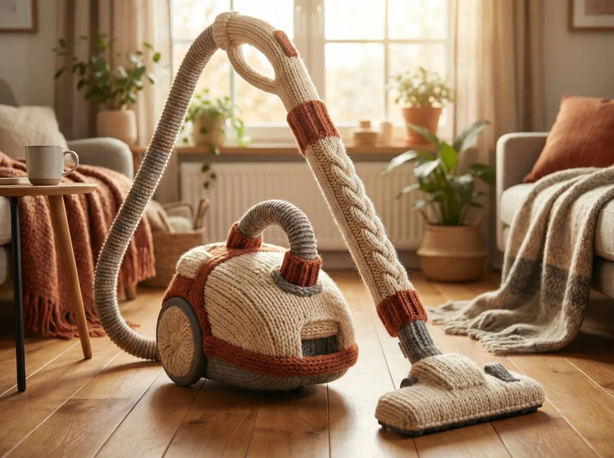

# Alexandra Aisling — by @AllaAisling

[← Back to Examples from X](../../EXAMPLES.md) · Category: Illustration & 3D · Model: `Nano Banana`

<a href="https://x.com/AllaAisling/status/2012909092210381048"></a>

Original post: **[@AllaAisling on X](https://x.com/AllaAisling/status/2012909092210381048)** · Creator: [Alexandra Aisling](https://x.com/AllaAisling)

## Prompt

```text
An [OBJECT] rendered as if entirely hand-knitted from chunky wool yarn, impossibly functional-looking despite being soft craft. Visible stitches, cable knit patterns on grip areas, ribbing where flexibility is needed, yarn ends neatly tucked. Positioned against a cozy lifestyle backdrop or clean wool-texture studio. Scandinavian hygge meets industrial design. Warm soft lighting emphasizing the yarn texture, the handmade quality, the absurd coziness of machinery. Sharp focus on stitch detail, warm saturated fiber colors, lifestyle product aesthetic, ultra-high resolution, the hard made soft.
```

## Try it

Paste the prompt into **[vinano.ai](https://vinano.ai?utm_source=github&utm_medium=readme&utm_campaign=awesome-image-video-prompts-updating&utm_content=x-page-try)** to generate your own version.

> The image and prompt belong to [@AllaAisling](https://x.com/AllaAisling) and are shown here with credit for reference. Creators can ask for changes or removal by opening an issue.
