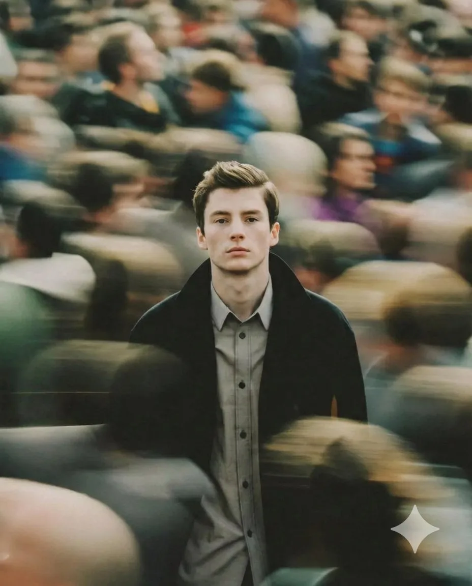

# Taaruk — by @Taaruk_

[← Back to Examples from X](../../EXAMPLES.md) · Category: Photography · Model: `Nano Banana`

<a href="https://x.com/Taaruk_/status/2026523437469253945"></a>

Original post: **[@Taaruk_ on X](https://x.com/Taaruk_/status/2026523437469253945)** · Creator: [Taaruk](https://x.com/Taaruk_)

## Prompt

```text
A cinematic portrait of a young man standing still in the middle of a busy crowd, sharp focus on the subject while people around him are heavily motion blurred, creating a dynamic sense of movement. The subject has a calm, serious expression, wearing a dark coat over a minimal outfit. Shot in a crowded urban environment, natural soft lighting, shallow depth of field, center composition. Long exposure effect with streaking motion blur surrounding the subject, ultra-realistic, 8K, high detail, cinematic color grading.
```

## Try it

Paste the prompt into **[vinano.ai](https://vinano.ai?utm_source=github&utm_medium=readme&utm_campaign=awesome-image-video-prompts-updating&utm_content=x-page-try)** to generate your own version.

> The image and prompt belong to [@Taaruk_](https://x.com/Taaruk_) and are shown here with credit for reference. Creators can ask for changes or removal by opening an issue.
