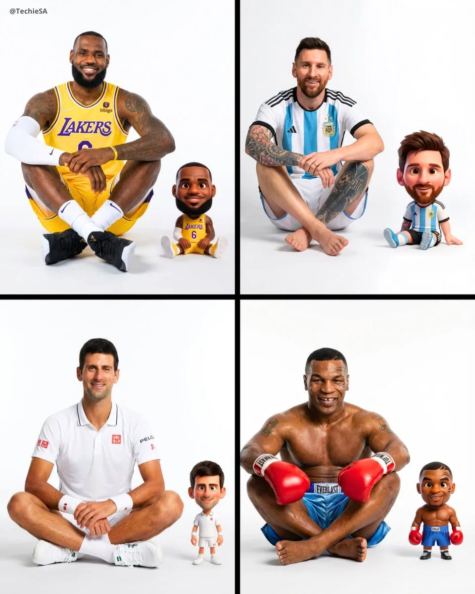

# TechieSA — by @TechieBySA

[← Back to Community Examples](../../EXAMPLES.md) · Category: Illustration & 3D · Model: `Nano Banana`

<a href="https://x.com/TechieBySA/status/2022679468666687588"></a>

Source: **[@TechieBySA on X](https://x.com/TechieBySA/status/2022679468666687588)** · Creator: [TechieSA](https://x.com/TechieBySA)

## Prompt

```text
Split composition portrait. PRIMARY SUBJECT (The Real Human - STRICT LIKENESS): On the left, a raw, hyper-realistic photograph of the person from the reference image. CRITICAL: The AI must preserve the exact facial geometry, bone structure, specific imperfections, and skin texture of the source image. Do not beautify or alter the face. This is a documentary-style portrait of the specific individual provided. The subject is wearing the outfit from the visual reference. Pose: Sitting cross-legged on the floor, facing forward, with an authentic smile. SECONDARY SUBJECT (The Miniature): On the right, a tiny, cute 3D Pixar-style animated character, standing or sitting next to the human. This character is a stylized caricature of the human, wearing a matching miniature outfit. SETTING: Seamless pure white studio background. Soft cinematic lighting. 8k resolution, uncropped. --iw 2 make them both hold a soccer ball
```

## Try it

Paste the prompt into **[vinano.ai](https://vinano.ai?utm_source=github&utm_medium=readme&utm_campaign=awesome-image-video-prompts-updating&utm_content=x-page-try)** to generate your own version.

> The image and prompt belong to @TechieBySA ([original post](https://x.com/TechieBySA/status/2022679468666687588)) and are shown here with credit for reference. Creators can ask for changes or removal by opening an issue.
