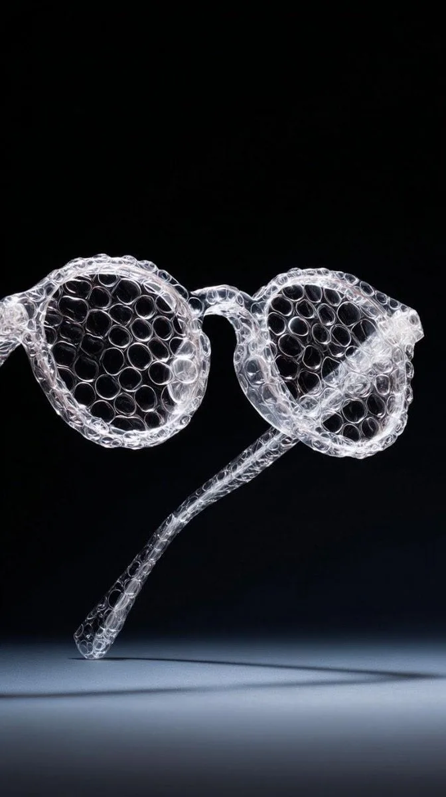

# Sharon Riley — by @Just_sharon7

[← Back to Examples from X](../../EXAMPLES.md) · Category: Illustration & 3D · Model: `Nano Banana`

<a href="https://x.com/Just_sharon7/status/2015757888283652351"></a>

Original post: **[@Just_sharon7 on X](https://x.com/Just_sharon7/status/2015757888283652351)** · Creator: [Sharon Riley](https://x.com/Just_sharon7)

## Prompt

```text
{
  "prompt": "A studio shot of a transparent bubble wrap fashion elegant [ITEM], empty with nothing inside. The material is clear, glossy, and highly detailed, capturing the texture of inflated bubbles. Minimalist composition, high-fashion editorial style, soft diffused studio lighting, neutral background, ultra-clean aesthetic, photorealistic rendering, sharp focus.",
  "style": {
    "lighting": "soft diffused studio lighting",
    "background": "neutral seamless backdrop",
    "mood": "modern, minimalist, elegant",
    "quality": "ultra-detailed, photorealistic",
    "material": "transparent bubble wrap"
  }
}
```

## Try it

Paste the prompt into **[vinano.ai](https://vinano.ai?utm_source=github&utm_medium=readme&utm_campaign=awesome-image-video-prompts-updating&utm_content=x-page-try)** to generate your own version.

> The image and prompt belong to [@Just_sharon7](https://x.com/Just_sharon7) and are shown here with credit for reference. Creators can ask for changes or removal by opening an issue.
