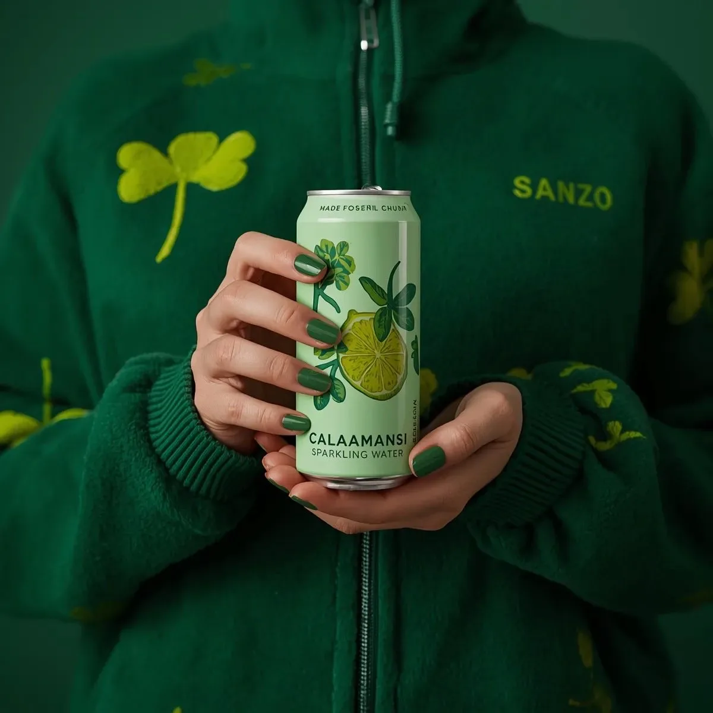

# Kashberg — by @Kashberg_0

[← Back to Community Examples](../../EXAMPLES.md) · Category: Product & Brand · Model: `Nano Banana`

<a href="https://x.com/Kashberg_0/status/2027171001486967062"></a>

Source: **[@Kashberg_0 on X](https://x.com/Kashberg_0/status/2027171001486967062)** · Creator: [Kashberg](https://x.com/Kashberg_0)

## Prompt

```text
A photorealistic product shot of a person holding a slim, light green can of Sanzo Calamansi Sparkling Water. The person is wearing a dark green, fuzzy fleece zip-up hoodie patterned with light green four-leaf clovers. Both hands are holding the can centrally in front of their torso, displaying perfectly manicured nails painted in a glossy green polish. The can features an illustration of a sliced calamansi lime with green leaves. The background is a solid, moody dark green, creating a striking monochromatic green aesthetic. Soft, professional studio lighting, highly detailed.
```

## Try it

Paste the prompt into **[vinano.ai](https://vinano.ai?utm_source=github&utm_medium=readme&utm_campaign=awesome-image-video-prompts-updating&utm_content=x-page-try)** to generate your own version.

> The image and prompt belong to @Kashberg_0 ([original post](https://x.com/Kashberg_0/status/2027171001486967062)) and are shown here with credit for reference. Creators can ask for changes or removal by opening an issue.
