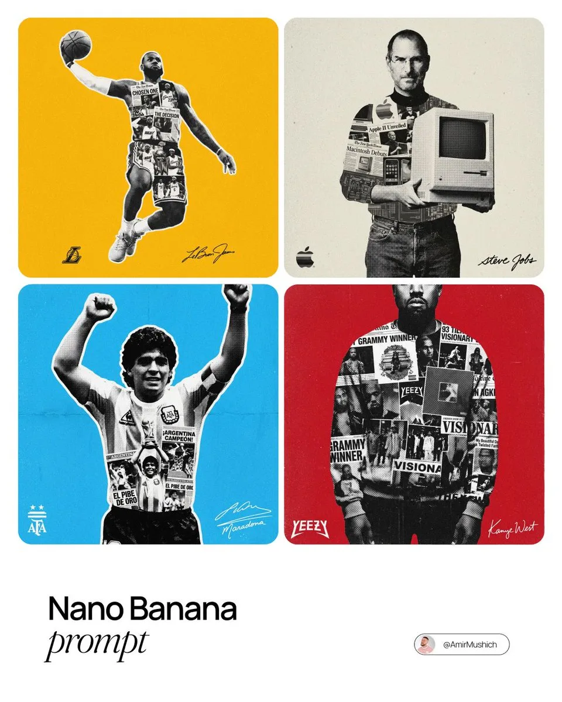

# AmirMušić — by @AmirMushich

[← Back to Examples from X](../../EXAMPLES.md) · Category: Poster Design · Model: `Nano Banana`

<a href="https://x.com/AmirMushich/status/2018776000532717836"></a>

Original post: **[@AmirMushich on X](https://x.com/AmirMushich/status/2018776000532717836)** · Creator: [AmirMušić](https://x.com/AmirMushich)

## Prompt

```text
[Lebron James]. Act as a graphic designer specializing in "Modern Vintage" sports and music memorabilia posters.
1. COLOR LOGIC (AUTONOMOUS):
Analyze the Subject: Instantly identify the single most iconic color associated with [PERSON / CHARACTER NAME] (e.g., if Michael Jordan -> Chicago Red; if Prince -> Purple; if Spotify CEO -> Vibrant Green).
The Background: Fill the entire background with this Solid, Vibrant Brand Color.
Texture: Apply a visible Heavy Film Grain overlay to the solid color to kill the digital perfection.
2. CENTRAL COMPOSITION (NARRATIVE SILHOUETTE):
The Container: Place a massive, high-contrast Black & White Cut-Out Photo of [PERSON / CHARACTER NAME] in the center. It can slightly breach the top or side borders (dynamic cropping).
The "Montage" Fill (CRITICAL): The interior of the subject's clothing or body shadows is NOT solid black. It is filled with a Complex Monochrome Collage.
Collage Content: Inside the silhouette, layer smaller, high-contrast photos representing key career milestones, newspaper headlines, famous poses, or relevant machinery/tools associated with them.
Visual Effect: This creates a "Double Exposure" effect where the hero's shape tells their story.
3. PRINT AESTHETIC (HALFTONE & NEWSPAPER):
Halftone Effect: Apply a distinct "Coarse Halftone Dot Pattern" (Newsprint Screen effect) to the entire central figure and collage. The dots should be visible, creating that retro 90s zine/newspaper aesthetic.
Contrast: The image must be strictly Duotone or Tritone (Background Color + Black Ink + White Paper negative space). No full-color photos.
4. FOOTER ELEMENTS (BRANDING):
Bottom Left (Logo): Place a specific Logo or Icon relevant to the subject (e.g., team logo, company logo, or personal symbol).
Size: Small and discrete (approx 15% of width).
Color: High contrast to the background (White or Black).
Bottom Right (Signature): Place the subject's Autograph/Signature.
Logic: If the signature is public domain, simulate the real one. If fictional, generate a believable handwritten script signature.
Color: Same contrast color as the logo.
OUTPUT:
A raw, textured, vintage-style poster design.
```

## Try it

Paste the prompt into **[vinano.ai](https://vinano.ai?utm_source=github&utm_medium=readme&utm_campaign=awesome-image-video-prompts-updating&utm_content=x-page-try)** to generate your own version.

> The image and prompt belong to [@AmirMushich](https://x.com/AmirMushich) and are shown here with credit for reference. Creators can ask for changes or removal by opening an issue.
