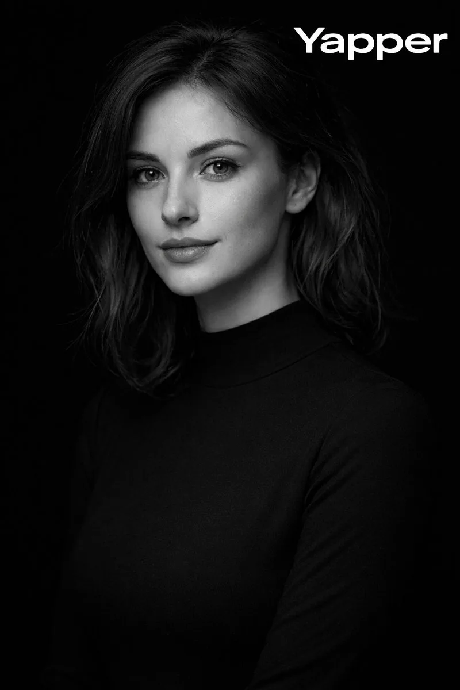

# Johnn — by @john_my07

[← Back to Community Examples](../../EXAMPLES.md) · Category: Photography · Model: `Nano Banana`

<a href="https://x.com/john_my07/status/2030802157679878498"></a>

Source: **[@john_my07 on X](https://x.com/john_my07/status/2030802157679878498)** · Creator: [Johnn](https://x.com/john_my07)

## Prompt

```text
{
"prompt": "High-contrast monochromatic studio portrait of a European woman around 25 years old. She has natural facial proportions, delicate cheekbones, expressive eyes, and realistic skin texture with visible pores and fine detail. Her expression is calm, elegant, and confident, looking softly toward the camera. She is posed gracefully with one hand lightly touching her neck and shoulders slightly angled. She is wearing a simple elegant black dress that softly frames her collarbones and shoulders. Hair is natural and softly styled with visible strand detail. Use minimal modern studio lighting with a single focused key light slightly above eye level, creating soft sculpted highlights on the face and subtle shadows for depth. Background is pure black, clean and textureless. Composition is a tight head-and-shoulders portrait with sharp focus on the eyes and shallow depth of field. Style: cinematic fine-art monochrome photography, modern editorial studio aesthetic, ultra-realistic, high contrast, 8K resolution, sharp micro-details."
}
```

## Try it

Paste the prompt into **[vinano.ai](https://vinano.ai?utm_source=github&utm_medium=readme&utm_campaign=awesome-image-video-prompts-updating&utm_content=x-page-try)** to generate your own version.

> The image and prompt belong to @john_my07 ([original post](https://x.com/john_my07/status/2030802157679878498)) and are shown here with credit for reference. Creators can ask for changes or removal by opening an issue.
