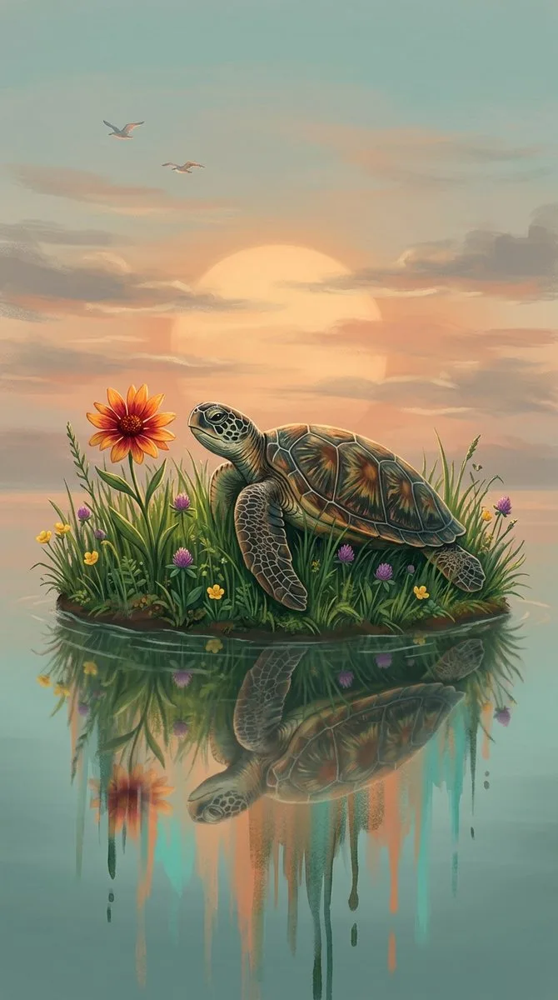

# Viki — by @churvikv

[← Back to Community Examples](../../EXAMPLES.md) · Category: Illustration & 3D · Model: `Nano Banana`

<a href="https://x.com/churvikv/status/2041512847016890622"></a>

Source: **[@churvikv on X](https://x.com/churvikv/status/2041512847016890622)** · Creator: [Viki](https://x.com/churvikv)

## Prompt

```text
A digital fantasy illustration of a small turtle resting on a grassy riverbank at twilight. The turtle has a detailed, textured shell with a soft, warm golden glow emanating from underneath its body, casting light onto the surrounding mossy earth. The scene is filled with magical, floating fireflies or glowing pollen particles that sparkle in the dim, atmospheric light. The turtle's reflection is clearly visible in the calm, still water below. Tall, slender blades of grass rise beside the turtle, silhouetted against a serene, muted gray-blue background. The overall mood is peaceful, ethereal, and cinematic, with high detail and soft, dreamlike lighting.
```

## Try it

Paste the prompt into **[vinano.ai](https://vinano.ai?utm_source=github&utm_medium=readme&utm_campaign=awesome-image-video-prompts-updating&utm_content=x-page-try)** to generate your own version.

> The image and prompt belong to @churvikv ([original post](https://x.com/churvikv/status/2041512847016890622)) and are shown here with credit for reference. Creators can ask for changes or removal by opening an issue.
