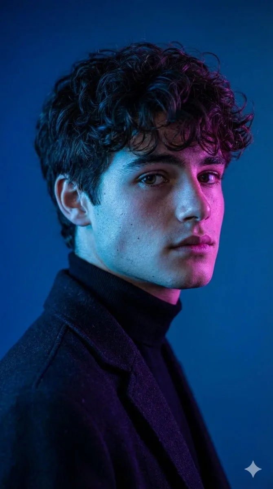

# Harboriis — by @harboriis

[← Back to Community Examples](../../EXAMPLES.md) · Category: Photography · Model: `Nano Banana`

<a href="https://x.com/harboriis/status/2016030160924156122"></a>

Source: **[@harboriis on X](https://x.com/harboriis/status/2016030160924156122)** · Creator: [Harboriis](https://x.com/harboriis)

## Prompt

```text
Ultra-realistic cinematic medium close-up portrait of the reference person, slightly turned to the side while looking toward the camera. Wearing a black turtleneck and dark jacket, modern and minimalist fashion style. Deep blue background with a smooth gradient, combined with contrasting magenta and blue lighting. Strong blue light coming from one side and magenta light from the opposite side, both colors reflecting clearly on the face and skin, creating a dramatic color contrast. High-end editorial lighting, sharp focus, realistic skin texture, cinematic mood, shallow depth of field.
```

## Try it

Paste the prompt into **[vinano.ai](https://vinano.ai?utm_source=github&utm_medium=readme&utm_campaign=awesome-image-video-prompts-updating&utm_content=x-page-try)** to generate your own version.

> The image and prompt belong to @harboriis ([original post](https://x.com/harboriis/status/2016030160924156122)) and are shown here with credit for reference. Creators can ask for changes or removal by opening an issue.
