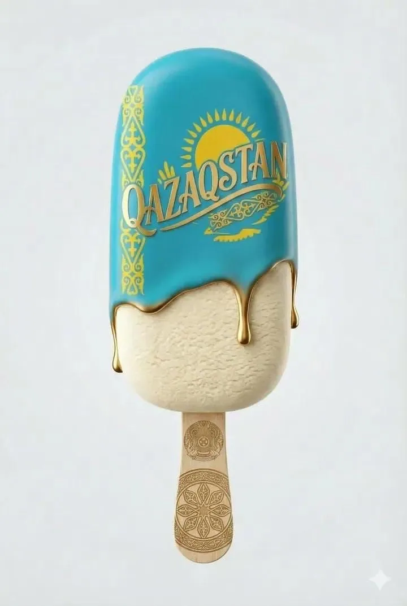

# Kashberg — by @Kashberg_0

[← Back to Examples from X](../../EXAMPLES.md) · Category: Food & Drink · Model: `Nano Banana`

<a href="https://x.com/Kashberg_0/status/2018170311364198617"></a>

Original post: **[@Kashberg_0 on X](https://x.com/Kashberg_0/status/2018170311364198617)** · Creator: [Kashberg](https://x.com/Kashberg_0)

## Prompt

```text
A minimalist, ultra-realistic product shot of a premium ice cream bar inspired by Kazakhstan. The popsicle is coated in glossy turquoise icing with elegant gold ornamental patterns and the word “QAZAQSTAN” embossed in metallic gold, featuring a golden sun-and-eagle motif. The lower half reveals creamy vanilla ice cream with smooth texture and subtle melting drips. Wooden stick engraved with traditional Kazakh patterns. Clean white studio background, soft diffused lighting, sharp focus, luxury food branding aesthetic, high-detail textures, modern cultural fusion design, 8K quality.
```

## Try it

Paste the prompt into **[vinano.ai](https://vinano.ai?utm_source=github&utm_medium=readme&utm_campaign=awesome-image-video-prompts-updating&utm_content=x-page-try)** to generate your own version.

> The image and prompt belong to [@Kashberg_0](https://x.com/Kashberg_0) and are shown here with credit for reference. Creators can ask for changes or removal by opening an issue.
