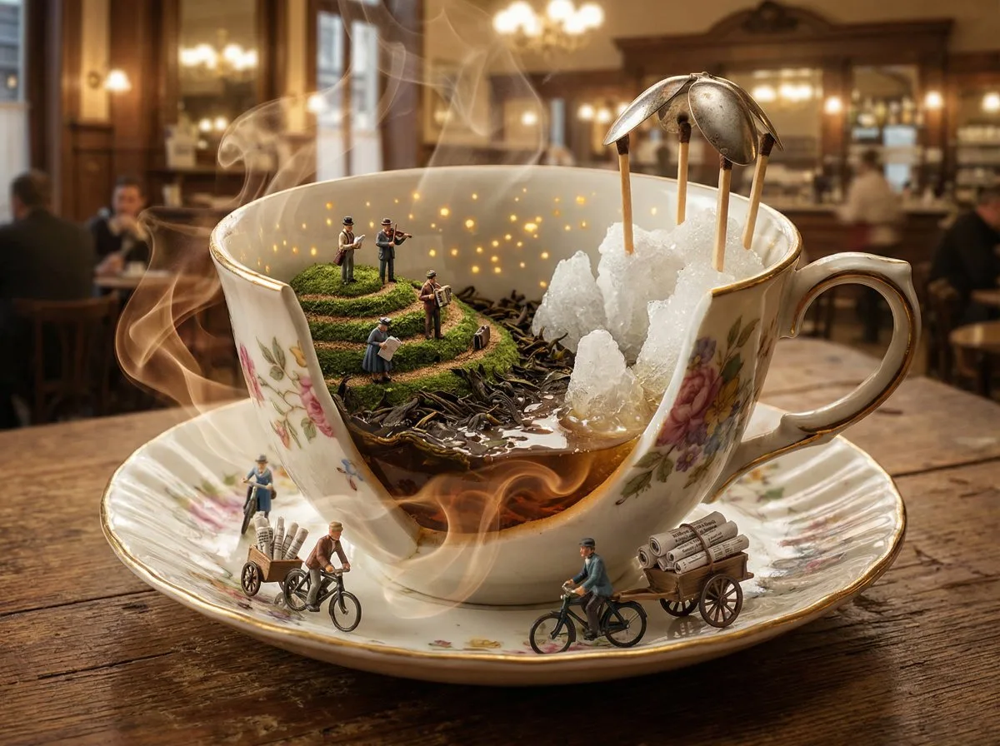

# Alexandra Aisling — by @AllaAisling

[← Back to Community Examples](../../EXAMPLES.md) · Category: Illustration & 3D · Model: `Nano Banana`

<a href="https://x.com/AllaAisling/status/2015806433556832401"></a>

Source: **[@AllaAisling on X](https://x.com/AllaAisling/status/2015806433556832401)** · Creator: [Alexandra Aisling](https://x.com/AllaAisling)

## Prompt

```text
A [AGE / ERA] [CONTAINER / OBJECT] associated with [CULTURE / CONTEXT], partially opened to reveal its contents transforming into a living landscape.
The material inside unfolds as a miniature world: [MATERIAL 1] becomes [GEOGRAPHIC FEATURE], [MATERIAL 2] forms [TERRAIN / STRUCTURE], [FINE DETAILS] flow like [NATURAL ELEMENTS].
Tiny [FIGURES / ENTITIES] inhabit the scene, moving through the terrain as part of a [JOURNEY / SYSTEM / ACTIVITY]. [CREATURES / VEHICLES] carry [SYMBOLIC LOADS] across [LANDMARKS].
A [SHELTER / HUB / ARCHITECTURE] constructed from [UNEXPECTED MATERIAL] serves as a gathering point. The interior surface of the object becomes a [SKY / MAP / COSMIC PATTERN] used for guidance or meaning.
The entire scene is unified by [ATMOSPHERIC ELEMENT] and [TEXTURAL DETAIL], evoking [ABSTRACT THEME / EMOTION].
Cinematic macro perspective, handcrafted realism, surreal scale contrast, warm directional lighting, tactile materials, poetic world-building.
```

## Try it

Paste the prompt into **[vinano.ai](https://vinano.ai?utm_source=github&utm_medium=readme&utm_campaign=awesome-image-video-prompts-updating&utm_content=x-page-try)** to generate your own version.

> The image and prompt belong to @AllaAisling ([original post](https://x.com/AllaAisling/status/2015806433556832401)) and are shown here with credit for reference. Creators can ask for changes or removal by opening an issue.
