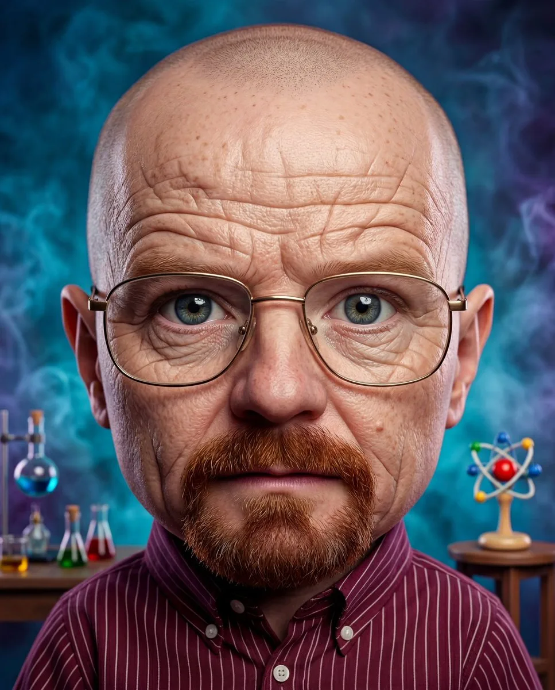

# WasifAI — by @doctorwasif

[← Back to Community Examples](../../EXAMPLES.md) · Category: Illustration & 3D · Model: `Nano Banana`

<a href="https://x.com/doctorwasif/status/2041499088990978244"></a>

Source: **[@doctorwasif on X](https://x.com/doctorwasif/status/2041499088990978244)** · Creator: [WasifAI](https://x.com/doctorwasif)

## Prompt

```text
Hyperrealistic baby @ image in a caricature style, with exaggerated facial features, finely detailed skin texture, meticulously styled hair, cinematic lighting, vibrant color grading, dynamic shadows and highlights, whimsical atmosphere, rendered with photo-real depth and rich composition
```

## Try it

Paste the prompt into **[vinano.ai](https://vinano.ai?utm_source=github&utm_medium=readme&utm_campaign=awesome-image-video-prompts-updating&utm_content=x-page-try)** to generate your own version.

> The image and prompt belong to @doctorwasif ([original post](https://x.com/doctorwasif/status/2041499088990978244)) and are shown here with credit for reference. Creators can ask for changes or removal by opening an issue.
