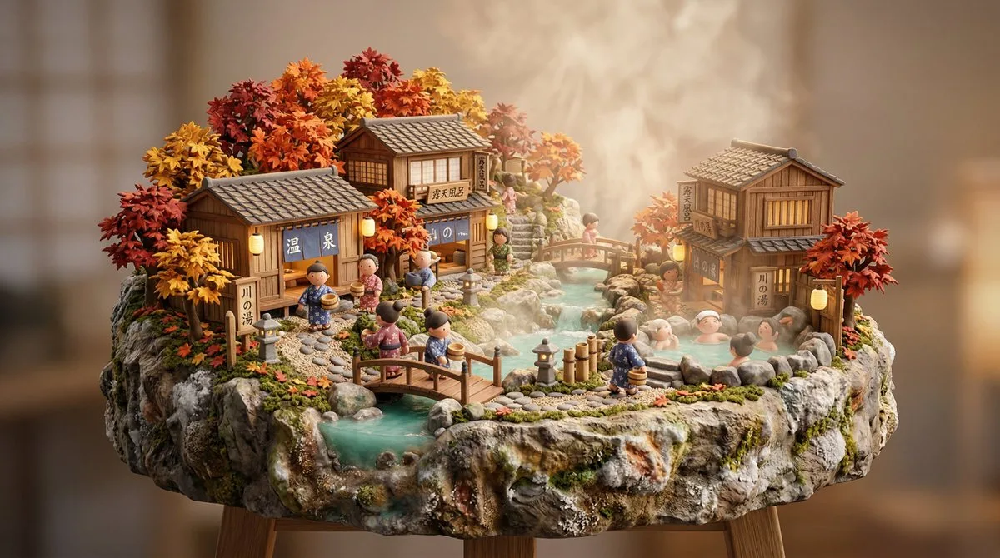

# Alexandra Aisling — by @AllaAisling

[← Back to Community Examples](../../EXAMPLES.md) · Category: Illustration & 3D · Model: `Nano Banana`

<a href="https://x.com/AllaAisling/status/2028672209544175970"></a>

Source: **[@AllaAisling on X](https://x.com/AllaAisling/status/2028672209544175970)** · Creator: [Alexandra Aisling](https://x.com/AllaAisling)

## Prompt

```text
3D miniature scene, a [JAPANESE ONSEN VILLAGE] with [wooden bathhouses, steam rising from natural hot springs, stone lanterns, maple trees in autumn color, guests in tiny yukata robes carrying wooden buckets], presented as a small platform diorama. The platform is carved from natural hot spring rock with mineral deposits. Side view, cute clay style, miniature diorama, soft rendered lighting effects, warm steam diffusing the light, light background.
```

## Try it

Paste the prompt into **[vinano.ai](https://vinano.ai?utm_source=github&utm_medium=readme&utm_campaign=awesome-image-video-prompts-updating&utm_content=x-page-try)** to generate your own version.

> The image and prompt belong to @AllaAisling ([original post](https://x.com/AllaAisling/status/2028672209544175970)) and are shown here with credit for reference. Creators can ask for changes or removal by opening an issue.
