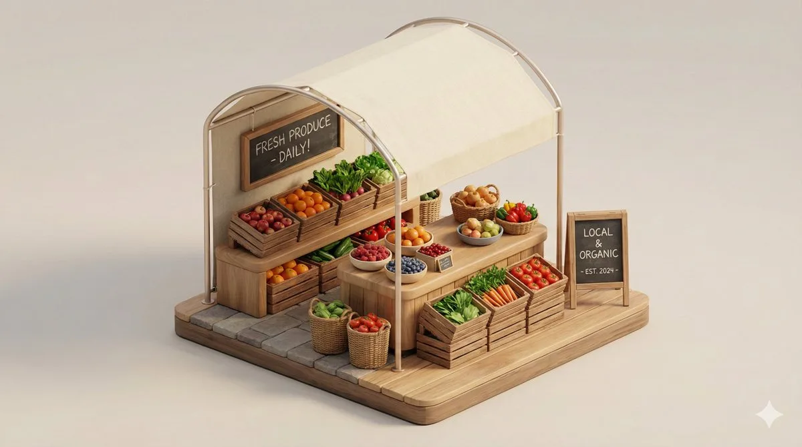

# Aleena Amir — by @aleenaamiir

[← Back to Examples from X](../../EXAMPLES.md) · Category: Illustration & 3D · Model: `Nano Banana`

<a href="https://x.com/aleenaamiir/status/2011750912390258844"></a>

Original post: **[@aleenaamiir on X](https://x.com/aleenaamiir/status/2011750912390258844)** · Creator: [Aleena Amir](https://x.com/aleenaamiir)

## Prompt

```text
A clean, minimal 3D isometric diorama of a [URBAN RETAIL TYPE], featuring a [MAIN COUNTER / DISPLAY OBJECT] placed on a [GROUND / PLATFORM TYPE], simple [CANOPY / ROOF STRUCTURE], subtle [SIGNAGE TYPE], smooth [SURFACE MATERIAL], soft studio lighting, realistic materials, rounded edges, miniature architectural model style, high detail, neutral background.
```

## Try it

Paste the prompt into **[vinano.ai](https://vinano.ai?utm_source=github&utm_medium=readme&utm_campaign=awesome-image-video-prompts-updating&utm_content=x-page-try)** to generate your own version.

> The image and prompt belong to [@aleenaamiir](https://x.com/aleenaamiir) and are shown here with credit for reference. Creators can ask for changes or removal by opening an issue.
