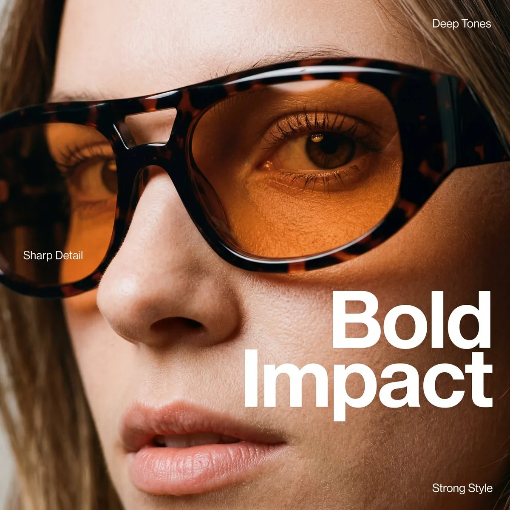

# Heisenberg — by @rovvmut_

[← Back to Community Examples](../../EXAMPLES.md) · Category: UI & Graphic · Model: `Nano Banana`

<a href="https://x.com/rovvmut_/status/2032343238015938917"></a>

Source: **[@rovvmut_ on X](https://x.com/rovvmut_/status/2032343238015938917)** · Creator: [Heisenberg](https://x.com/rovvmut_)

## Prompt

```text
An extreme close-up, high-fashion editorial portrait focusing on the right side of a person's face. The composition is a tight crop showing the bridge of the nose, a portion of the lips, and a single eye peering through sunglasses. The shot is characterized by a heavy, cinematic film grain and a warm, sophisticated studio atmosphere.
Eyewear: Large-frame, wrap-around sunglasses made of high-gloss dark tortoiseshell acetate (mottled black and deep mahogany). The lenses are a vibrant, translucent amber-orange, allowing the eye and eyelashes behind the lens to remain visible but color-tinted.
Person: A person with smooth skin showing natural texture and fine pores. The lighting is soft-side lighting from the right, creating a gentle shadow on the left side of the nose and a subtle highlight on the cheekbone and lower lip.
Typography: Bold, white, geometric sans-serif text reading "Bold Impact" is overlaid on the lower-right cheek. Three smaller, delicate labels are scattered: "Deep Tones" (top right), "Sharp Detail" (on the left lens), and "Strong Style" (bottom right).
Color Palette: A rich mix of skin tones (#E8A88A), burnt orange (#B8541C), and deep espresso (#1A0D0B), contrasted with crisp white text (#FFFFFF).
Lighting: Warm studio lighting with a soft-focus depth of field. The background consists of out-of-focus hair and skin, keeping all attention on the eye and the texture of the acetate frames.
Atmosphere: Premium, editorial fashion magazine aesthetic; high-contrast but with soft transitions.
```

## Try it

Paste the prompt into **[vinano.ai](https://vinano.ai?utm_source=github&utm_medium=readme&utm_campaign=awesome-image-video-prompts-updating&utm_content=x-page-try)** to generate your own version.

> The image and prompt belong to @rovvmut_ ([original post](https://x.com/rovvmut_/status/2032343238015938917)) and are shown here with credit for reference. Creators can ask for changes or removal by opening an issue.
