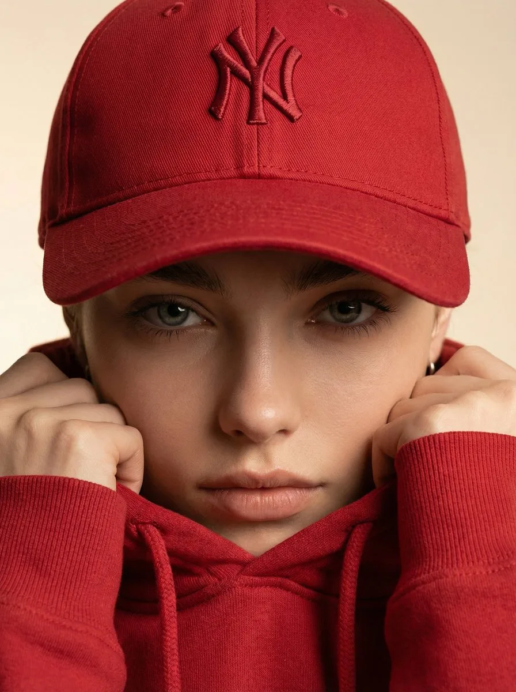

# K — by @ChillaiKalan__

[← Back to Community Examples](../../EXAMPLES.md) · Category: Photography · Model: `Nano Banana`

<a href="https://x.com/ChillaiKalan__/status/2018171062580920797"></a>

Source: **[@ChillaiKalan__ on X](https://x.com/ChillaiKalan__/status/2018171062580920797)** · Creator: [K](https://x.com/ChillaiKalan__)

## Prompt

```text
Ultra-realistic fashion beauty crop of a female model wearing the reference red baseball cap and matching red hoodie. Framing: Tight portrait crop from nose to forehead, cap and eyes filling the frame. Focus: The embroidered logo perfectly centered above the model’s eyes, stitching detail and thread depth clearly visible. Pose: Model gripping the hoodie collar softly with both hands, creating subtle fabric folds. Lighting: Soft frontal studio light with faint shadow sculpting on cheekbones and under the cap. Background: Minimal warm studio backdrop, ivory-to-beige gradient. Mood: Bold, confident, fashion-house campaign energy. Finish: Ultra-sharp fabric detail, cinematic realism, shallow depth of field, no text, no branding overlays.
```

## Try it

Paste the prompt into **[vinano.ai](https://vinano.ai?utm_source=github&utm_medium=readme&utm_campaign=awesome-image-video-prompts-updating&utm_content=x-page-try)** to generate your own version.

> The image and prompt belong to @ChillaiKalan__ ([original post](https://x.com/ChillaiKalan__/status/2018171062580920797)) and are shown here with credit for reference. Creators can ask for changes or removal by opening an issue.
