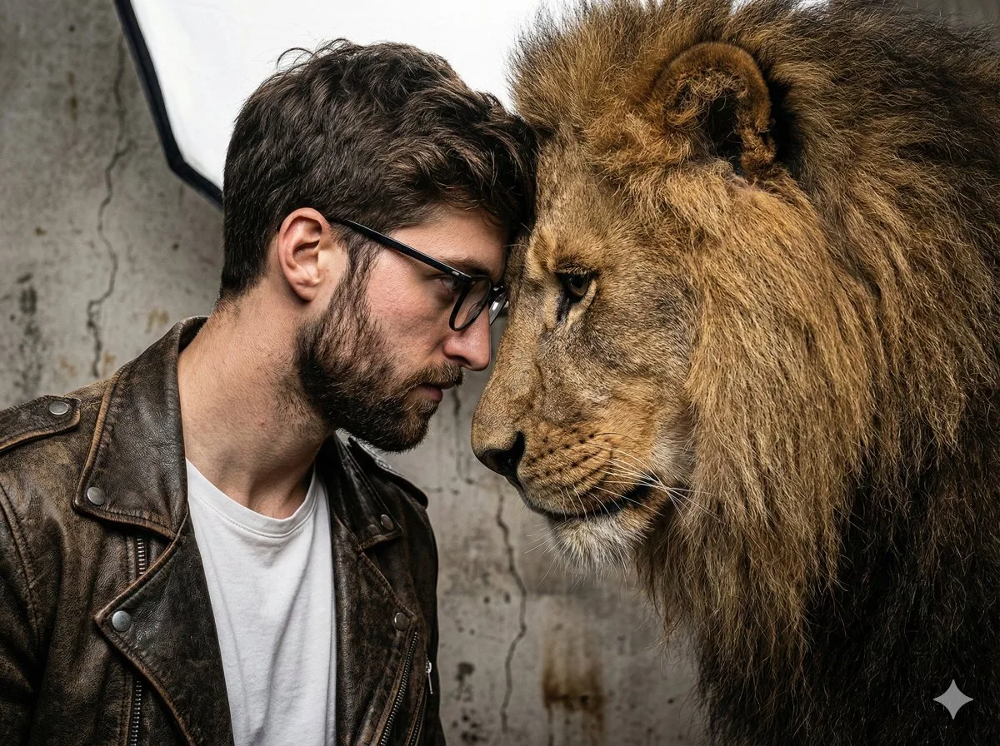

# Duet | AI — by @Sheldon056

[← Back to Community Examples](../../EXAMPLES.md) · Category: Photography · Model: `Nano Banana`

<a href="https://x.com/Sheldon056/status/2011789728421671033"></a>

Source: **[@Sheldon056 on X](https://x.com/Sheldon056/status/2011789728421671033)** · Creator: [Duet | AI](https://x.com/Sheldon056)

## Prompt

```text
A gritty, intense portrait of a man, a friend of real lion, captured in a raw, hyper-realistic style. The background is a textured, neutral concrete wall, keeping the environment simple and industrial. Lighting is soft and diffuse, provided by a large octagon softbox, mimicking overcast daylight. The camera is a Canon EOS R5 with an 85mm f/1.2 lens. The subject, with the [face from reference image], is forehead-to-forehead with the lion, displaying a deep bond. He wears a distressed leather motorcycle jacket and a white t-shirt, embracing a classic rebel aesthetic. The 8K image captures the pores on his skin and the coarse individual hairs of the lion's mane. The HDR aesthetic ensures vibrant colors and deep shadows, making the image feel three-dimensional and alive.
```

## Try it

Paste the prompt into **[vinano.ai](https://vinano.ai?utm_source=github&utm_medium=readme&utm_campaign=awesome-image-video-prompts-updating&utm_content=x-page-try)** to generate your own version.

> The image and prompt belong to @Sheldon056 ([original post](https://x.com/Sheldon056/status/2011789728421671033)) and are shown here with credit for reference. Creators can ask for changes or removal by opening an issue.
