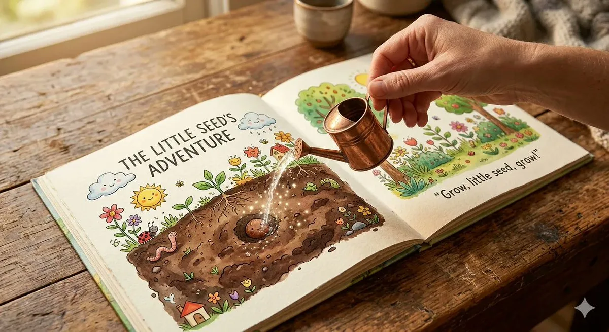

# Sharon Riley — by @Just_sharon7

[← Back to Examples from X](../../EXAMPLES.md) · Category: Illustration & 3D · Model: `Nano Banana`

<a href="https://x.com/Just_sharon7/status/2038525426084323378"></a>

Original post: **[@Just_sharon7 on X](https://x.com/Just_sharon7/status/2038525426084323378)** · Creator: [Sharon Riley](https://x.com/Just_sharon7)

## Prompt

```text
{
  "prompt": "An open children’s picture book rests on a wooden table, showing a whimsical illustration of a small brown seed in cartoon soil. A realistic human hand pours water from a tiny can, with a sparkling stream. Warm golden light, magical mood, overhead close-up, photorealistic, 4K.",
  "style": "photorealistic",
  "lighting": "warm golden",
  "mood": "magical",
  "perspective": "overhead close-up",
  "resolution": "4K",
  "elements": [
    {
      "type": "book",
      "description": "children’s picture book open on wooden table"
    },
    {
      "type": "illustration",
      "description": "whimsical small brown seed in cartoon soil"
    },
    {
      "type": "hand",
      "description": "realistic human hand pouring water from tiny can"
    },
    {
      "type": "water",
      "description": "sparkling stream"
    }
  ]
}
```

## Try it

Paste the prompt into **[vinano.ai](https://vinano.ai?utm_source=github&utm_medium=readme&utm_campaign=awesome-image-video-prompts-updating&utm_content=x-page-try)** to generate your own version.

> The image and prompt belong to [@Just_sharon7](https://x.com/Just_sharon7) and are shown here with credit for reference. Creators can ask for changes or removal by opening an issue.
