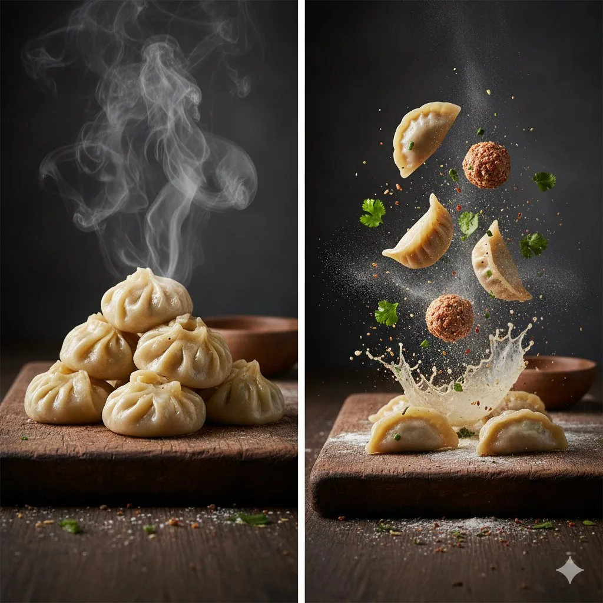

# Meem — by @mehvishs25

[← Back to Examples from X](../../EXAMPLES.md) · Category: Food & Drink · Model: `Nano Banana`

<a href="https://x.com/mehvishs25/status/2019098547451568397"></a>

Original post: **[@mehvishs25 on X](https://x.com/mehvishs25/status/2019098547451568397)** · Creator: [Meem](https://x.com/mehvishs25)

## Prompt

```text
{
The Cinematic Momo Duo
Subject & Scene
 * Finished Dish: Freshly steamed dumplings (momos) stacked on a rustic wooden board.
 * The Details: Glossy dough with delicate handmade pleats, a light sheen of oil, and thick dramatic steam rising.
 * Exploded View: A side-by-side or split scene showing the "deconstructed" momo. Floating dumpling wrappers, balls of spiced minced filling, and scattered fresh herbs.
Motion & Action
 * Frozen in Time: Flour particles suspended mid-air, motion-frozen spices, and a dramatic slow-motion splash effect.
 * Atmosphere: Wispy, swirling steam and falling herb leaves.
Setting & Background
 * Environment: A dark, moody, rustic kitchen.
 * Surface: A weathered, textured wooden cutting board with grains and cracks visible.
Lighting & Color
 * Style: Cinematic studio lighting.
 * Palette: Warm, inviting tones with high contrast and deep shadows for a professional editorial look.
Technical Specs
 * Camera: Macro photography, 8K resolution, hyper-detailed textures.
 * Focus: Shallow depth of field (blurred background) with sharp, crisp focus on the ingredients.
```

## Try it

Paste the prompt into **[vinano.ai](https://vinano.ai?utm_source=github&utm_medium=readme&utm_campaign=awesome-image-video-prompts-updating&utm_content=x-page-try)** to generate your own version.

> The image and prompt belong to [@mehvishs25](https://x.com/mehvishs25) and are shown here with credit for reference. Creators can ask for changes or removal by opening an issue.
