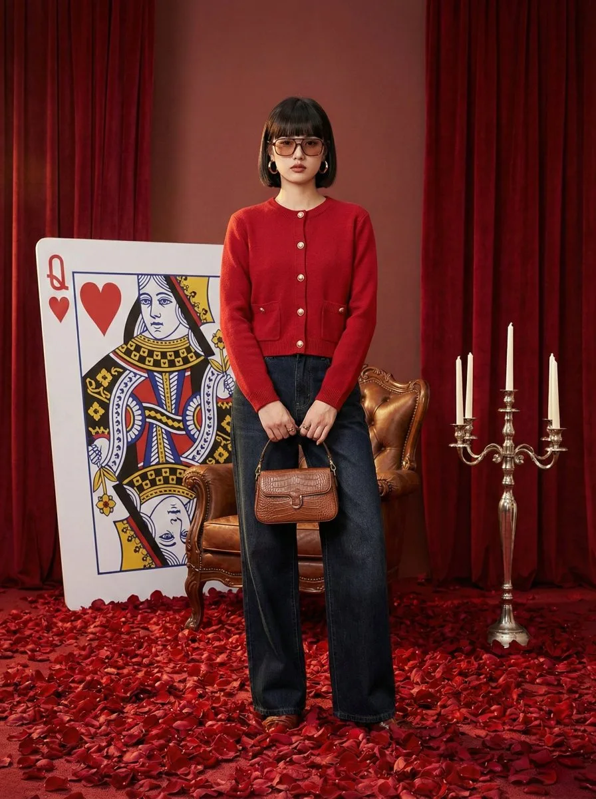

# Heisenberg — by @rovvmut_

[← Back to Examples from X](../../EXAMPLES.md) · Category: Photography · Model: `Nano Banana`

<a href="https://x.com/rovvmut_/status/2022587678328525084"></a>

Original post: **[@rovvmut_ on X](https://x.com/rovvmut_/status/2022587678328525084)** · Creator: [Heisenberg](https://x.com/rovvmut_)

## Prompt

```text
{
  "meta": {
    "image_quality": "High",
    "image_type": "Studio Photography",
    "resolution_estimation": "1024x1280",
    "file_characteristics": {
      "compression_artifacts": "Low",
      "noise_level": "None",
      "lens_type_estimation": "Standard Prime (approx. 50mm)"
    }
  },
  "global_context": {
    "scene_description": "A fashion editorial shot featuring a woman in a red cardigan and dark jeans standing in a surreal Alice in Wonderland-themed studio. The floor is covered in a thick layer of red rose petals. Behind her sits a vintage leather armchair and a giant 'Queen of Hearts' playing card leaned against red velvet curtains. A silver candelabra with white candles stands to the right.",
    "environment_type": "Studio",
    "time_of_day": "N/A (Indoor Artificial)",
    "weather_atmosphere": "Theatrical, Romantic, Surreal",
    "lighting": {
      "source": "Studio Softboxes",
      "direction": "Frontal-left (45-degree angle)",
      "quality": "Soft",
      "color_temperature": "Warm Neutral (~3200K - 4000K)"
    },
    "color_palette": {
      "dominant_hex_estimates": [
        "#8B0000",
        "#E31B23",
        "#1A1B2E",
        "#FFFFFF"
      ],
      "accent_colors": [
        "#C5A059",
        "#000000"
      ],
      "contrast_level": "High"
    }
  },
  "composition": {
    "camera_angle": "Eye-level",
    "framing": "Full-body shot",
    "depth_of_field": "Medium (background elements slightly soft but legible)",
    "focal_point": "The woman in the red cardigan",
    "symmetry_type": "None",
    "rule_of_thirds_alignment": "Subject is centered horizontally; eyes align with the upper third line."
  },
  "objects": [
    {
      "id": "obj_001",
      "label": "Female Model",
      "category": "Person",
      "location": {
        "relative_position": "Center",
        "bounding_box_percentage": {
          "x": 25.0,
          "y": 14.0,
          "width": 30.0,
          "height": 70.0
        }
      },
      "dimensions_relative": "Large",
      "distance_from_camera": "Near",
      "pose_orientation": "Standing upright, slightly turned to the left, looking directly at camera.",
      "material": "Skin, hair, fabric",
      "surface_properties": {
        "texture": "Smooth skin, soft knit, denim",
        "reflectivity": "Low",
        "micro_details": "Dark bob haircut, gold hoop earrings, tinted glasses.",
        "wear_state": "Pristine"
      },
      "color_details": {
        "base_color_hex": "#E31B23",
        "secondary_colors": [
          "#1A1B2E"
        ],
        "gradient_or_pattern": "Solid colors"
      },
      "interaction_with_light": {
        "shadow_casting": "Soft shadow cast to the right and onto the floor petals",
        "highlight_zones": "Left side of face and cardigan shoulder",
        "translucency": "None"
      },
      "relationships": [
        {
          "type": "wearing",
          "target_object_id": "obj_002"
        },
        {
          "type": "holding",
          "target_object_id": "obj_004"
        }
      ]
    },
    {
      "id": "obj_002",
      "label": "Red Cardigan",
      "category": "Clothing",
      "location": {
        "relative_position": "Upper Center",
        "bounding_box_percentage": {
          "x": 26.0,
          "y": 24.0,
          "width": 25.0,
          "height": 26.0
        }
      },
      "dimensions_relative": "Medium",
      "distance_from_camera": "Near",
      "pose_orientation": "Buttoned at the top, open at the bottom",
      "material": "Knitted wool/cashmere",
      "surface_properties": {
        "texture": "Ribbed cuffs and hem, fine knit body",
        "reflectivity": "None",
        "micro_details": "Four visible gold-tone circular buttons",
        "wear_state": "New"
      },
      "color_details": {
        "base_color_hex": "#E31B23",
        "secondary_colors": [
          "#C5A059"
        ],
        "gradient_or_pattern": "Solid"
      },
      "interaction_with_light": {
        "shadow_casting": "Folds create soft internal shadows",
        "highlight_zones": "Upper shoulders and sleeve edges"
      }
    },
    {
      "id": "obj_003",
      "label": "Wide-leg Jeans",
      "category": "Clothing",
      "location": {
        "relative_position": "Lower Center",
        "bounding_box_percentage": {
          "x": 29.0,
          "y": 41.0,
          "width": 26.0,
          "height": 42.0
        }
      },
      "dimensions_relative": "Medium-Large",
      "distance_from_camera": "Near",
      "pose_orientation": "Straight vertical hang",
      "material": "Denim",
      "surface_properties": {
        "texture": "Coarse weave, visible center crease/seam",
        "reflectivity": "None",
        "micro_details": "Contrast stitching, black belt with gold buckle",
        "wear_state": "New"
      },
      "color_details": {
        "base_color_hex": "#1A1B2E",
        "secondary_colors": [
          "#C5A059"
        ],
        "gradient_or_pattern": "Dark indigo wash"
      }
    },
    {
      "id": "obj_004",
      "label": "Handbag",
      "category": "Accessory",
      "location": {
        "relative_position": "Center-Right (Model's hand)",
        "bounding_box_percentage": {
          "x": 37.0,
          "y": 62.0,
          "width": 15.0,
          "height": 10.0
        }
      },
      "dimensions_relative": "Small",
      "distance_from_camera": "Near",
      "pose_orientation": "Held by chain strap",
      "material": "Leather, Metal",
      "surface_properties": {
        "texture": "Embossed/quilted paisley-like pattern",
        "reflectivity": "Medium (chain and leather sheen)",
        "micro_details": "Silver-tone chain link strap",
        "wear_state": "New"
      },
      "color_details": {
        "base_color_hex": "#000000",
        "secondary_colors": [
          "#C0C0C0"
        ]
      }
    },
    {
      "id": "obj_005",
      "label": "Queen of Hearts Card",
      "category": "Prop",
      "location": {
        "relative_position": "Mid-Right",
        "bounding_box_percentage": {
          "x": 58.0,
          "y": 35.0,
          "width": 30.0,
          "height": 40.0
        }
      },
      "dimensions_relative": "Large",
      "distance_from_camera": "Mid",
      "pose_orientation": "Leaning against background at a 45-degree angle",
      "material": "Cardboard/Foamcore",
      "surface_properties": {
        "texture": "Matte",
        "reflectivity": "Low",
        "micro_details": "Stylized 'Q' and heart icons in corners",
        "wear_state": "Pristine"
      },
      "color_details": {
        "base_color_hex": "#FFFFFF",
        "secondary_colors": [
          "#E31B23"
        ]
      },
      "text_content": {
        "raw_text": "Q",
        "font_style": "Serif",
        "font_weight": "Bold",
        "text_case": "Uppercase",
        "alignment": "Corner-aligned",
        "color_hex": "#E31B23"
      }
    },
    {
      "id": "obj_006",
      "label": "Candelabra",
      "category": "Furniture/Prop",
      "location": {
        "relative_position": "Far Right",
        "bounding_box_percentage": {
          "x": 81.0,
          "y": 29.0,
          "width": 18.0,
          "height": 45.0
        }
      },
      "dimensions_relative": "Medium",
      "distance_from_camera": "Mid",
      "pose_orientation": "Standing vertical",
      "material": "Silver Metal, Wax",
      "surface_properties": {
        "texture": "Polished/Metallic",
        "reflectivity": "High",
        "micro_details": "Ornate curved arms, three visible white tapered candles (unlit)",
        "wear_state": "New"
      },
      "color_details": {
        "base_color_hex": "#C0C0C0",
        "secondary_colors": [
          "#FFFFFF"
        ]
      }
    },
    {
      "id": "obj_007",
      "label": "Rose Petals",
      "category": "Decor",
      "location": {
        "relative_position": "Bottom / Floor",
        "bounding_box_percentage": {
          "x": 0.0,
          "y": 72.0,
          "width": 100.0,
          "height": 28.0
        }
      },
      "dimensions_relative": "Large (as a group)",
      "distance_from_camera": "Near to Mid",
      "pose_orientation": "Scattered randomly",
      "material": "Organic / Silk",
      "surface_properties": {
        "texture": "Velvety/Soft",
        "reflectivity": "Low",
        "micro_details": "Varying shades of red, slight curling at edges",
        "wear_state": "Fresh"
      },
      "color_details": {
        "base_color_hex": "#8B0000",
        "secondary_colors": [
          "#E31B23"
        ]
      }
    }
  ],
  "background_details": {
    "texture": "Velvet Drapes",
    "patterns": "Vertical heavy folds/pleats",
    "lighting_behavior": "Absorbs light in deep folds, soft sheen on raised edges",
    "additional_elements": [
      "Vintage brown leather tufted armchair (partially obscured)",
      "Large cluster of red roses near the base of the card"
    ]
  },
  "foreground_elements": {
    "particles": "None",
    "artifacts": "Slight floor-level haze where light meets petals"
  },
  "reconstruction_notes": {
    "mandatory_elements_for_recreation": "Red knit cardigan with gold buttons, dark wide-leg denim, floor covered in red rose petals, oversized Queen of Hearts card, red velvet curtain backdrop.",
    "sensitivity_factors": "The specific saturation of the red (cardigan must match curtains and petals), the height of the petal layer (must feel thick/carpeting), and the theatrical studio lighting.",
    "ambiguities": "The exact texture of the handbag's embossing is complex; the model's footwear is almost entirely hidden by the wide-leg jeans and petals."
  }
}
```

## Try it

Paste the prompt into **[vinano.ai](https://vinano.ai?utm_source=github&utm_medium=readme&utm_campaign=awesome-image-video-prompts-updating&utm_content=x-page-try)** to generate your own version.

> The image and prompt belong to [@rovvmut_](https://x.com/rovvmut_) and are shown here with credit for reference. Creators can ask for changes or removal by opening an issue.
