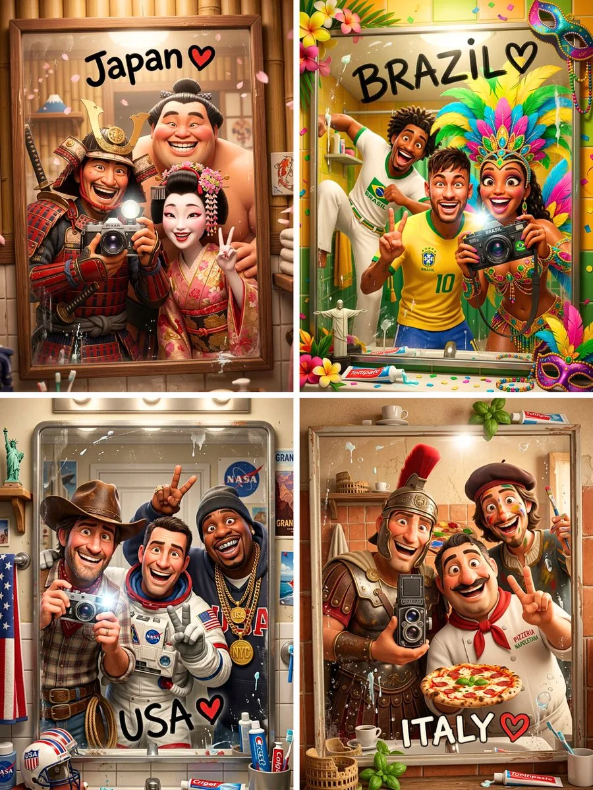

# TechieSA — by @TechieBySA

[← Back to Examples from X](../../EXAMPLES.md) · Category: Illustration & 3D · Model: `Nano Banana`

<a href="https://x.com/TechieBySA/status/2033551007062409422"></a>

Original post: **[@TechieBySA on X](https://x.com/TechieBySA/status/2033551007062409422)** · Creator: [TechieSA](https://x.com/TechieBySA)

## Prompt

```text
High-quality stylized 3D CGI Pixar-style render, vertical 3:4 composition, three most iconic and recognizable cultural figures from [COUNTRY] captured as a chaotic and joyful bathroom mirror selfie; the most visually striking figure holds the large vintage camera up toward the mirror in their most authentic traditional costume, the remaining figures squeezed tightly into the frame each wearing their most iconic outfit and showing their most signature expression or pose; everyone crammed together filling the entire mirror frame with faces large and close to the camera, tightly packed with no empty space, chaotic crowded energy; facial proportions gently stylized in Disney/Pixar animation style with expressive eyes while faithfully preserving each character's most authentic cultural costume and recognizable traits; the bathroom mirror has realistic toothpaste splatters and water droplets; the reflection shows bold black Pixar-style lettering reading "[COUNTRY]❤️"; the bathroom background is styled to match the cultural identity of [COUNTRY] with authentic thematic props, traditional decorations and iconic landmark easter eggs placed naturally around the scene; lighting combines soft ambient bathroom lighting with a bright camera flash reflecting in the mirror; warm Pixar-style color grading, ultra-detailed 4K render, no watermark
```

## Try it

Paste the prompt into **[vinano.ai](https://vinano.ai?utm_source=github&utm_medium=readme&utm_campaign=awesome-image-video-prompts-updating&utm_content=x-page-try)** to generate your own version.

> The image and prompt belong to [@TechieBySA](https://x.com/TechieBySA) and are shown here with credit for reference. Creators can ask for changes or removal by opening an issue.
