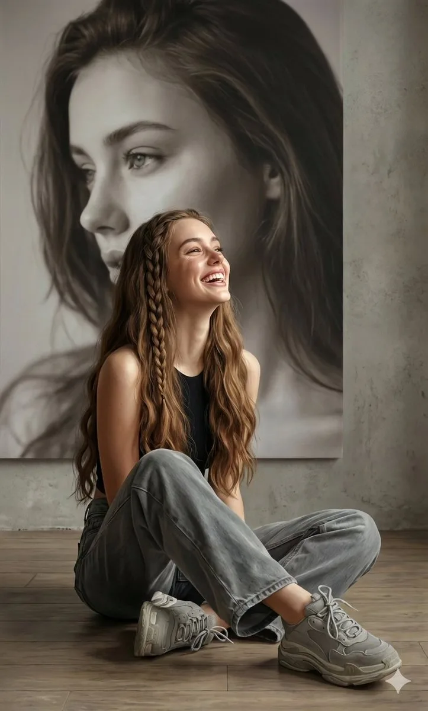

# Harboriis — by @harboriis

[← Back to Examples from X](../../EXAMPLES.md) · Category: Photography · Model: `Nano Banana`

<a href="https://x.com/harboriis/status/2011785693056679970"></a>

Original post: **[@harboriis on X](https://x.com/harboriis/status/2011785693056679970)** · Creator: [Harboriis](https://x.com/harboriis)

## Prompt

```text
Using the provided photos, create a highly detailed, professional, hyperrealistic art portrait, keeping the face intact. The woman sits elegantly on the floor, wearing a modern black top, soft, loose gray jeans, and chunky, fashionable gray sneakers. She has long, wavy, waist-length hair, half of which is braided. She has a laughing expression, and her gaze is directed upward.

The background should be an artistic monochrome composition (black and white) depicting a soft close-up from the side of the same face in profile
```

## Try it

Paste the prompt into **[vinano.ai](https://vinano.ai?utm_source=github&utm_medium=readme&utm_campaign=awesome-image-video-prompts-updating&utm_content=x-page-try)** to generate your own version.

> The image and prompt belong to [@harboriis](https://x.com/harboriis) and are shown here with credit for reference. Creators can ask for changes or removal by opening an issue.
