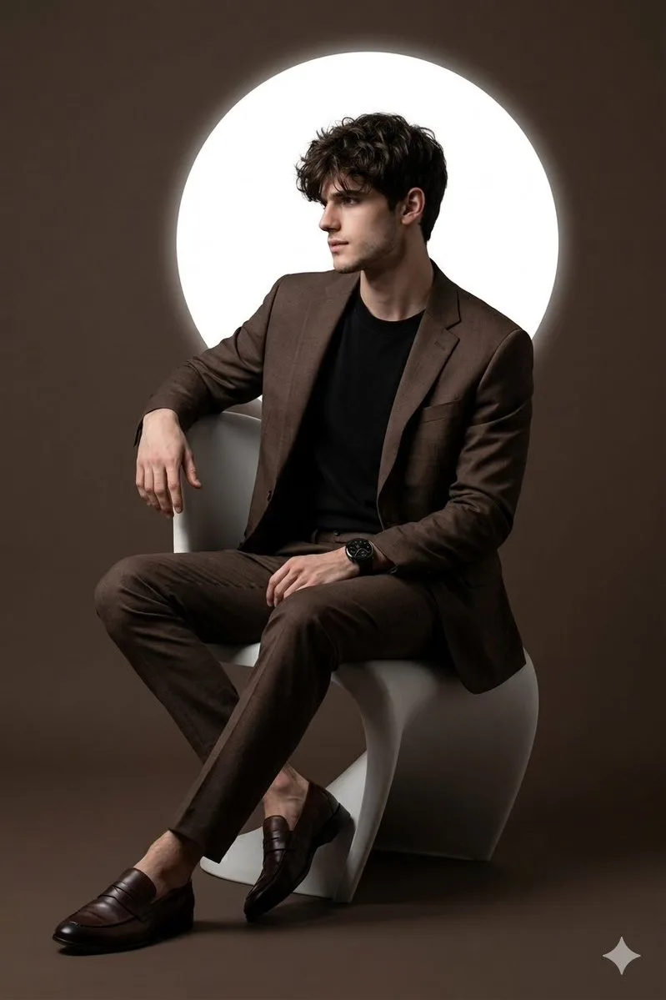

# Harboris — by @harboriis

[← Back to Community Examples](../../EXAMPLES.md) · Category: Photography · Model: `Nano Banana`

<a href="https://x.com/harboriis/status/2040040156066140196"></a>

Source: **[@harboriis on X](https://x.com/harboriis/status/2040040156066140196)** · Creator: [Harboris](https://x.com/harboriis)

## Prompt

```text
Use The Uploaded Reference Photo As The Model For The Face, Hairstyle, And Beard, Keeping Them Exactly As In The Reference. Render A Cinematic Studio Portrait Of A Young Man With A Sporty Body Sitting Casually On A Futuristic, Minimalistic, Designer Chair, Legs Crossed. Outfit: Brown Suit (#483c32 Jacket And Pants), Black Shirt Under The Jacket, Dark Brown Loafers, Black Oneplus Watch 346mm On Left Wrist. Background: Solid #483c32 With A Large White Circle Behind The Head, Filled And Slightly Glowing. Lighting: Bright Soft Studio Light, Producing Sharp Shadows And Moody Atmosphere. Pose: Relaxed, Slightly Leaning, One Hand On The Chair's Backrest, Face Turned To The Side. Ultra-detailed, Photo Realistic, Cinematic Contrast, Fabric Texture Emphasized. Ensure The Hairstyle, Beard, And Face Remain Exactly As In The Uploaded Reference Photo.
```

## Try it

Paste the prompt into **[vinano.ai](https://vinano.ai?utm_source=github&utm_medium=readme&utm_campaign=awesome-image-video-prompts-updating&utm_content=x-page-try)** to generate your own version.

> The image and prompt belong to @harboriis ([original post](https://x.com/harboriis/status/2040040156066140196)) and are shown here with credit for reference. Creators can ask for changes or removal by opening an issue.
