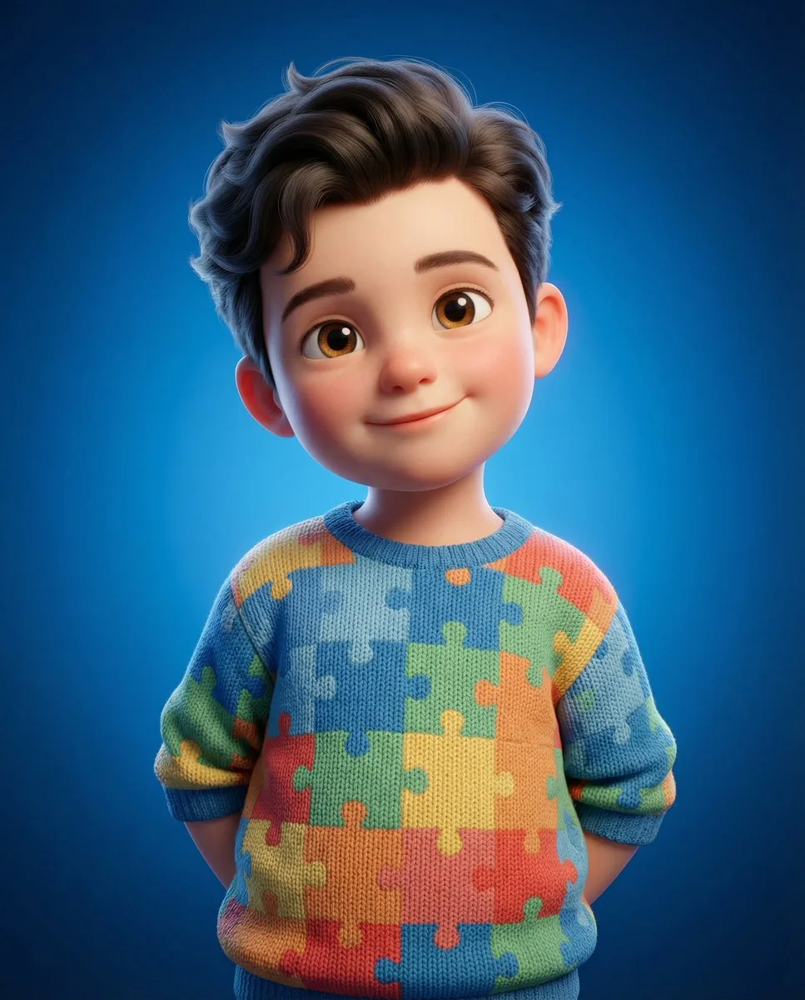

# K — by @ChillaiKalan__

[← Back to Examples from X](../../EXAMPLES.md) · Category: Illustration & 3D · Model: `Nano Banana`

<a href="https://x.com/ChillaiKalan__/status/2038114762945655072"></a>

Original post: **[@ChillaiKalan__ on X](https://x.com/ChillaiKalan__/status/2038114762945655072)** · Creator: [K](https://x.com/ChillaiKalan__)

## Prompt

```text
soft, round face
fuller cheeks
small chin
slightly larger, expressive eyes (but still identity-consistent)
no beard, no sharp jawline, no adult features
Expression should be innocent, warm, and slightly playful, with a gentle smile and direct eye contact.
Body proportions should be cute and childlike (small, slightly chubby body, slightly larger head).

Pose: relaxed standing with hands behind the back, with a subtle natural tilt in head and shoulders to avoid stiffness.
Hair should match the reference but appear soft, slightly voluminous, and naturally styled, not overly sharp or artificial.
Skin should be soft and stylized, with subtle subsurface scattering (SSS) for a warm glow, matte finish (no plastic shine), and gentle natural blush on cheeks.
The character wears a half sleeves cotton sweater with a puzzle pattern, where:

colors are soft but lively and slightly vibrant
not oversaturated and not washed out
The fabric shows a realistic knit texture and soft folds
Lighting should be soft and cinematic:

key light from upper-left
gentle fill light
subtle rim light on hair
Background should be a rich blue gradient, brighter behind the subject and darker toward the edges, with smooth depth (not flat).
Output should be:

1:1 aspect ratio
mid-length framing (head to waist)
high-detail, clean 3D render
film-quality finish (not toy-like, not overly realistic)
```

## Try it

Paste the prompt into **[vinano.ai](https://vinano.ai?utm_source=github&utm_medium=readme&utm_campaign=awesome-image-video-prompts-updating&utm_content=x-page-try)** to generate your own version.

> The image and prompt belong to [@ChillaiKalan__](https://x.com/ChillaiKalan__) and are shown here with credit for reference. Creators can ask for changes or removal by opening an issue.
