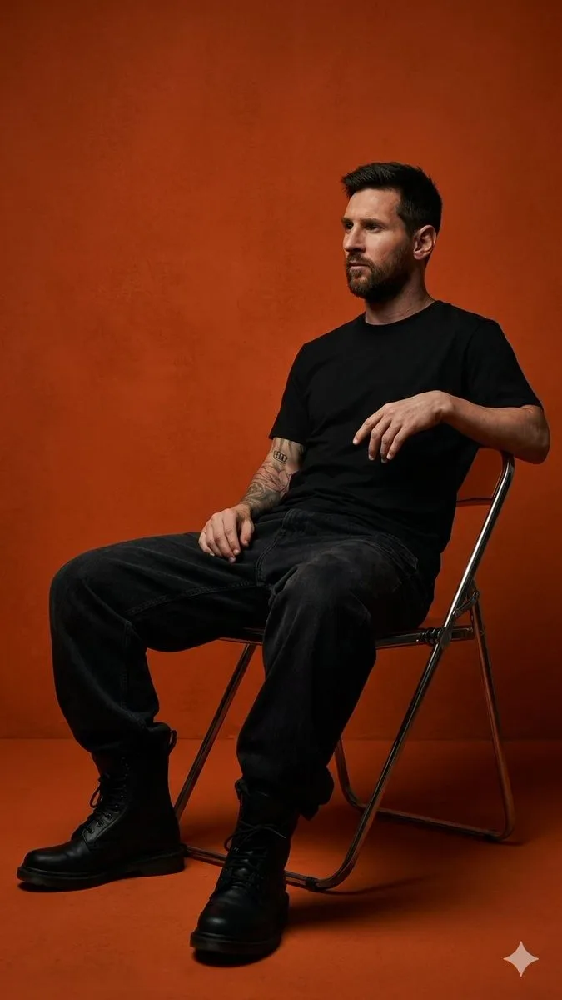

# Harboris — by @harboriis

[← Back to Examples from X](../../EXAMPLES.md) · Category: Photography · Model: `Nano Banana`

<a href="https://x.com/harboriis/status/2040257925126693248"></a>

Original post: **[@harboriis on X](https://x.com/harboriis/status/2040257925126693248)** · Creator: [Harboris](https://x.com/harboriis)

## Prompt

```text
Use model (the person in the image) you create a dark orange studio photo featuring a young man sitting casually on a metal folding chair with his legs cross. He's wearing a denim black baggy jeans, black t-shirt and black boots. The lightning is soft and minimal, producing sharp shadows and a moody atmosphere. His pose is relaxed, slightly leaning with one hand on the chair's backrest, his face turn to the side and modern aesthetic.
```

## Try it

Paste the prompt into **[vinano.ai](https://vinano.ai?utm_source=github&utm_medium=readme&utm_campaign=awesome-image-video-prompts-updating&utm_content=x-page-try)** to generate your own version.

> The image and prompt belong to [@harboriis](https://x.com/harboriis) and are shown here with credit for reference. Creators can ask for changes or removal by opening an issue.
