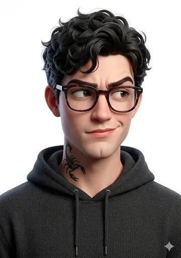

# Kashberg — by @Kashberg_0

[← Back to Examples from X](../../EXAMPLES.md) · Category: Illustration & 3D · Model: `Nano Banana`

<a href="https://x.com/Kashberg_0/status/2029817553288319295"></a>

Original post: **[@Kashberg_0 on X](https://x.com/Kashberg_0/status/2029817553288319295)** · Creator: [Kashberg](https://x.com/Kashberg_0)

## Prompt

```text
3D stylized character portrait of a young man, curly dark hair, wearing black round glasses and a dark hoodie, subtle smirk expression while looking sideways, small tattoo on the neck, smooth skin, highly detailed Pixar-style character design, soft studio lighting, clean light gray background, ultra-sharp, cinematic render, high detail, modern animated film style.
```

## Try it

Paste the prompt into **[vinano.ai](https://vinano.ai?utm_source=github&utm_medium=readme&utm_campaign=awesome-image-video-prompts-updating&utm_content=x-page-try)** to generate your own version.

> The image and prompt belong to [@Kashberg_0](https://x.com/Kashberg_0) and are shown here with credit for reference. Creators can ask for changes or removal by opening an issue.
