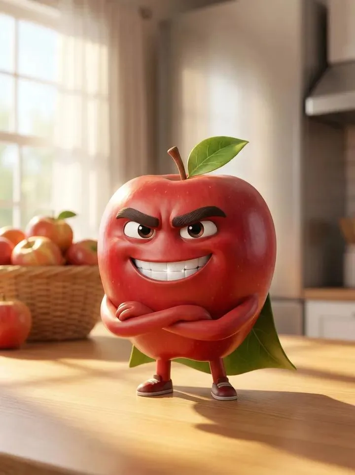

# 𝐌 — by @Strength04_X

[← Back to Examples from X](../../EXAMPLES.md) · Category: Illustration & 3D · Model: `Nano Banana`

<a href="https://x.com/Strength04_X/status/2025495088668008917"></a>

Original post: **[@Strength04_X on X](https://x.com/Strength04_X/status/2025495088668008917)** · Creator: [𝐌](https://x.com/Strength04_X)

## Prompt

```text
A Pixar-style 3D animated character of a single red apple. Handsome male character with sharp confident eyes, thick stylish eyebrows, and a wide charismatic grin showing bright white sparkling teeth. Smooth slightly glossy red skin texture with subtle highlights and natural gradients. The apple has small cartoon arms and legs, standing upright with arms crossed in a proud hero-like pose.

Teeth are shiny and perfectly white with small sparkle effects. In the background, a basket of apples is slightly blurred. The character is standing on a wooden dining table near a sunny window in a cozy modern home. Vibrant colors, cinematic lighting, soft shadows, high-fidelity textures, ultra-detailed, 8k.
```

## Try it

Paste the prompt into **[vinano.ai](https://vinano.ai?utm_source=github&utm_medium=readme&utm_campaign=awesome-image-video-prompts-updating&utm_content=x-page-try)** to generate your own version.

> The image and prompt belong to [@Strength04_X](https://x.com/Strength04_X) and are shown here with credit for reference. Creators can ask for changes or removal by opening an issue.
